<div align="center">


# WAS Node Suite v3

**779 nodes for ComfyUI. Image, video, 3D, language models and the plumbing between them.**<br>
MIT since 2023 · over a million downloads · nothing installed, nothing fetched unless you ask

 [](https://github.com/WASasquatch/open-manager-comfyui)  [](https://discord.gg/y7FRDaNNun) [](https://paypal.me/ThompsonJordan?country.x=US&locale.x=en_US)

**[Install](#install)** · **[What's inside](#highlights-of-what-youll-find)** · **[Hosted services](#hosted-services)** · **[Node reference](NODES.md)** · **[Features](FEATURES.md)** · **[144 example workflows](docs/WORKFLOWS.md)** · **[Models](docs/MODELS.md)** · **[Configuration](docs/CONFIG.md)** · **[Upgrading from v2](#upgrading-from-v2)**

</div>

---

<table>
<tr>
<td width="33%"><a href="docs/BLOCKOUT.md">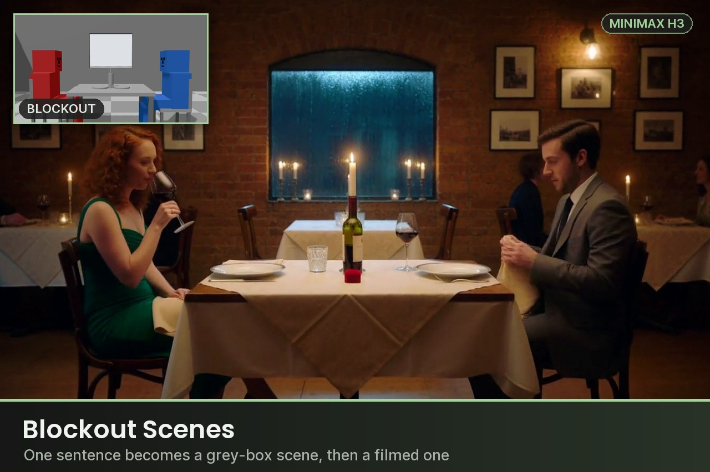</a></td>
<td width="33%"><a href="docs/H3_COND_TIMELINE.md">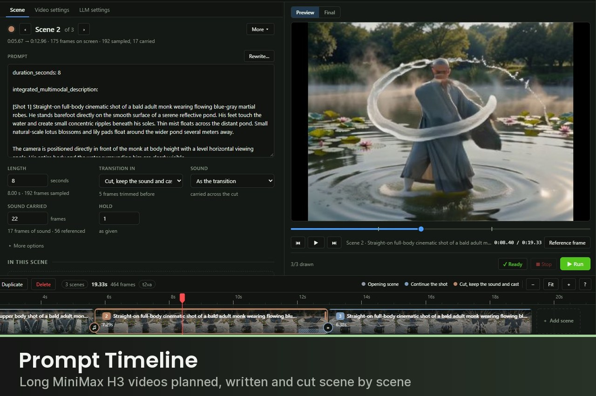</a></td>
<td width="33%"><a href="docs/IMAGE_EDITING.md">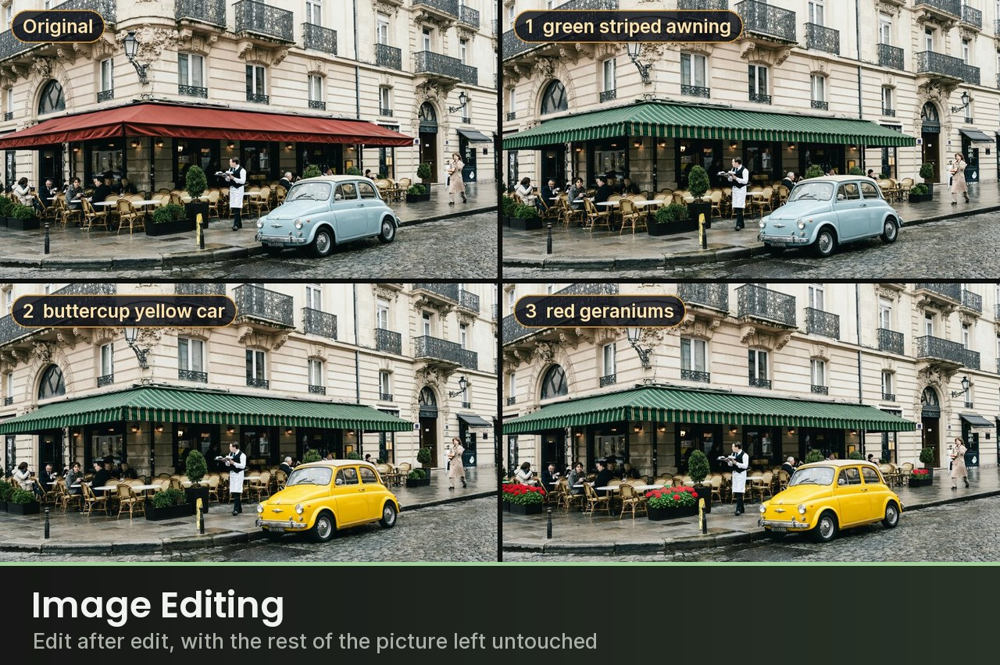</a></td>
</tr>
<tr>
<td><a href="docs/3D.md">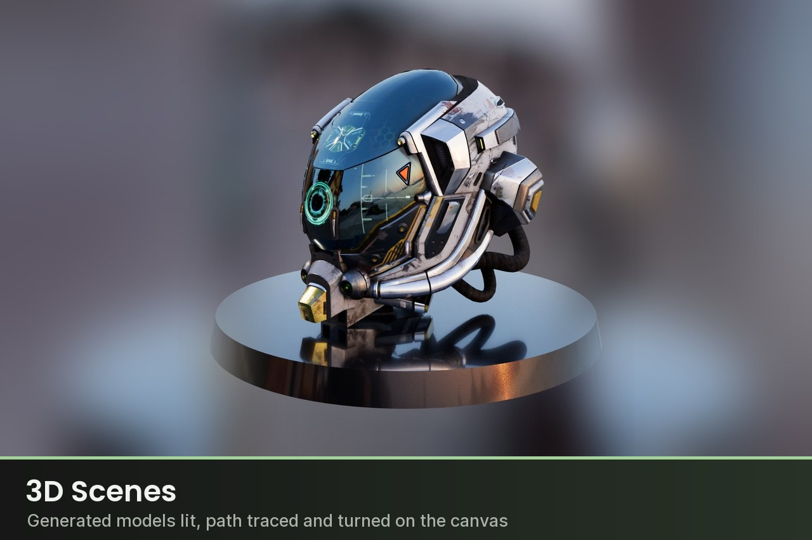</a></td>
<td><a href="FEATURES.md#content-viewer">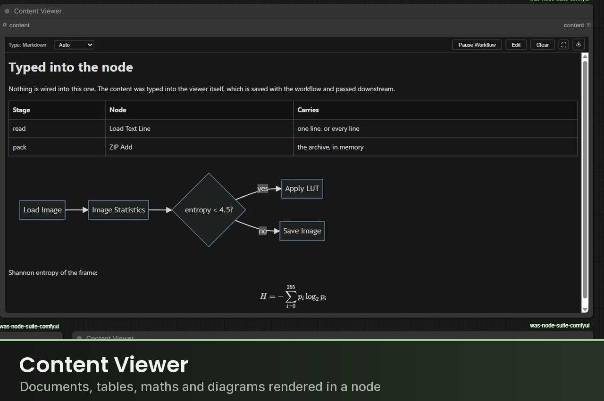</a></td>
<td><a href="docs/LLM.md">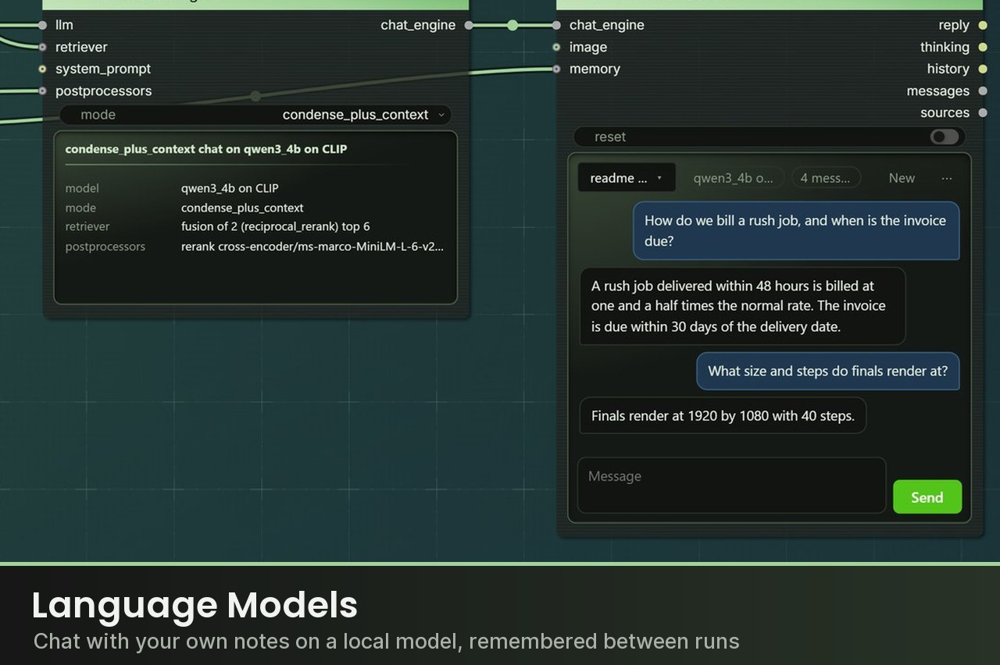</a></td>
</tr>
</table>

---

<div align="center">

## Highlights of What You'll Find

<table>
<tr>
<td width="50%" valign="top">

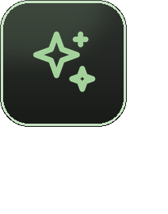

**Image generation and sampling**<br>
Tiled and affine samplers, noise shaping, shift and schedule control, model quantizing, LoRA stacks.<br>
<sub>[17 example workflows](docs/WORKFLOWS.md#image-generation-and-sampling)</sub>

</td>
<td width="50%" valign="top">

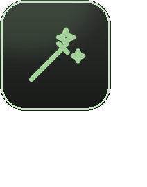

**Image editing**<br>
Crop-and-restore edits, edit regions, MiniMax H3 Image, Fibo 2.0, BluePixel 4K.<br>
<sub>[10 example workflows](docs/WORKFLOWS.md#image-editing)</sub>

</td>
</tr>
<tr>
<td valign="top">


**Photo and film looks**<br>
Raw-style develop, film stocks, a darkroom, looks baked into LUTs.<br>
<sub>[4 example workflows](docs/WORKFLOWS.md#photo-and-film-looks)</sub>

</td>
<td valign="top">

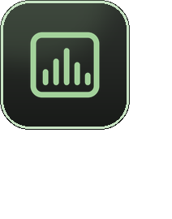

**Colour, HDR and scopes**<br>
Levels, LUTs, ACES and colour spaces, linear light, HDR video, scopes and charts.<br>
<sub>[5 example workflows](docs/WORKFLOWS.md#colour-hdr-and-scopes)</sub>

</td>
</tr>
<tr>
<td valign="top">


**Masks, regions and subjects**<br>
Skin, face and subject masks, masks drawn on the picture, subjects followed through a clip.<br>
<sub>[7 example workflows](docs/WORKFLOWS.md#masks-regions-and-subjects)</sub>

</td>
<td valign="top">

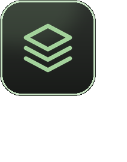

**Filters, layers and preprocessors**<br>
Filters and optics, layer stacks, layered PSD and TIFF, ControlNet preprocessors.<br>
<sub>[10 example workflows](docs/WORKFLOWS.md#filters-layers-and-preprocessors)</sub>

</td>
</tr>
<tr>
<td valign="top">

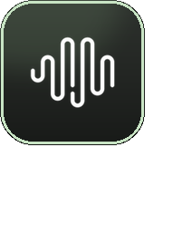

**MiniMax H3 video**<br>
The Prompt Timeline, long videos built a segment at a time, upscaling, sparse attention, Pika H3 Flex.<br>
<sub>[20 example workflows](docs/WORKFLOWS.md#minimax-h3-video)</sub>

</td>
<td valign="top">

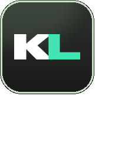

**Kandinsky 6 video**<br>
Video with sound, and video super-resolution of any length.<br>
<sub>[3 example workflows](docs/WORKFLOWS.md#kandinsky-6-video)</sub>

</td>
</tr>
<tr>
<td valign="top">


**Video editing and restoration**<br>
Edits, transitions and titles, restored footage, faces restored through a shot, audio mixing and beats.<br>
<sub>[8 example workflows](docs/WORKFLOWS.md#video-editing-and-restoration)</sub>

</td>
<td valign="top">

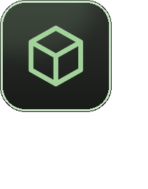

**3D and Three.js**<br>
Scenes, generated models, characters and meshes, blockouts, point cloud worlds, Video Blueprint.<br>
<sub>[24 example workflows](docs/WORKFLOWS.md#3d-and-threejs)</sub>

</td>
</tr>
<tr>
<td valign="top">

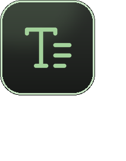

**Prompts and text**<br>
Prompt terminology, a style library, a system prompt library, text, lists and dictionaries.<br>
<sub>[9 example workflows](docs/WORKFLOWS.md#prompts-and-text)</sub>

</td>
<td valign="top">


**Language models and Llama-Index**<br>
Local and hosted models, documents, indexes, retrieval, chat, memory, tools and agents.<br>
<sub>[11 example workflows](docs/WORKFLOWS.md#language-models-and-llama-index)</sub>

</td>
</tr>
<tr>
<td valign="top">

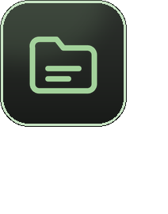

**Files, datasets and documents**<br>
Archives, folders, captioned training sets checked and fixed, a pose library, document export.<br>
<sub>[7 example workflows](docs/WORKFLOWS.md#files-datasets-and-documents)</sub>

</td>
<td valign="top">

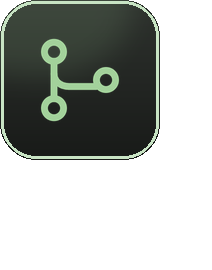

**Logic, loops and apps**<br>
Comparisons, switches, For and While loops, gates, numbers, apps built from a graph.<br>
<sub>[8 example workflows](docs/WORKFLOWS.md#logic-loops-and-apps)</sub>

</td>
</tr>
</table>

## **Runs natively through ComfyUI**. No wrappers. _No Diffusers._

&nbsp;
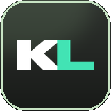&nbsp;
<br>
<sub>MiniMax H3 · Kandinsky 6 · vivo BluePixel 4K · Fibo 2.0 · MOSS-Image · FLUX 3 Image Klein</sub>


### See **[FEATURES.md](FEATURES.md)**, and every node with its inputs, outputs and tooltips is in **[NODES.md](NODES.md)**.

---

## Why WAS-NS

<font size="3">**One of the first packs to put hundreds of nodes into ComfyUI users' and bussinesses hands, rebuilt from the ground up for a modern ComfyUI**<br>
Since 2023, over a million downloads on Comfy Registry alone, and in daily use by thousands of people.</font>


<table>
<tr>
<td width="50%" valign="top">

### 🎬 The whole pipeline in one pack
Write it with a language model, generate it, edit it, grade it, film it, upscale it, cut it to
music and save it, without leaving ComfyUI. 779 nodes, 144 example workflows ready to open.

</td>
<td width="50%" valign="top">

### 🆓 Free for anything
MIT since the first commit. Use it, change it, teach with it, build a product on it, run it in
paid services. The 176 third-party files it bundles each ship with their own licence.
[docs/THIRD_PARTY.md](docs/THIRD_PARTY.md)

</td>
</tr>
<tr>
<td valign="top">

### 🚀 New models, native
MiniMax H3, Kandinsky 6, Fibo 2.0, BluePixel 4K and MOSS-Image run on ComfyUI's own model
loading and memory management, in int8, W6A8 and W4A8 as well as full precision.

</td>
<td valign="top">

### 🪶 Lean by design
Nothing to install beyond a clone. No packages by default, nothing pulled from a git URL, and no
download unless you switch the network on. Optional groups stay off until you want them.

</td>
</tr>
<tr>
<td valign="top">

### 🛡️ Safe to host
No outbound request unless allowed, no process started, no package installed at run time. Every
file a node names is checked against an allowlist first, and API keys never ride in a workflow.
[SECURITY.md](SECURITY.md)

</td>
<td valign="top">

### 🔍 Nodes that show their work
Panels draw before and after, size changes, what a loader read and what a run measured, right on
the node. No extra preview wiring to see whether it worked.

</td>
</tr>
<tr>
<td valign="top">

### 📦 Weights hosted, links included
Example workflows name every model they load, so ComfyUI offers each missing file with its download
address. [docs/MODELS.md](docs/MODELS.md)

</td>
<td valign="top">

### 🔁 Your v2 workflows still open
213 of the 220 v2 node ids are unchanged, and old settings are carried onto the new widgets as a
workflow loads. [Upgrading from v2](#upgrading-from-v2)

</td>
</tr>
</table>

---

## Hosted services

The pack's language model, embedding and tool nodes reach hosted APIs with a key read from an
environment variable. A workflow never carries a key. **[docs/LLM.md](docs/LLM.md)** lists each
variable and address.

| Kind | Services |
|---|---|
| Language models | OpenAI · Anthropic · Google Gemini · Groq · DeepSeek · xAI · Mistral · OpenRouter · Together AI · Fireworks AI · Perplexity · Cerebras · NVIDIA |
| Embeddings | OpenAI · Google Gemini |
| Agent web search | Tavily · Brave Search · Monid |
| Servers on your machine | Ollama · LM Studio · vLLM · llama.cpp server, plus any OpenAI-compatible endpoint in `config.yaml` |
| 3D generators | Models from ComfyUI's Tripo, Hunyuan3D, Meshy and Rodin nodes go straight into a Three.js scene with **Three Load Model** |

The same nodes also run fully local: GGUF files, Hugging Face folders, and the Qwen3 or Gemma
already loaded inside a core **Load CLIP**.

---

## Install

> [!WARNING]
> Install v3 by cloning or through [Open Manager](https://github.com/WASasquatch/open-manager-comfyui). ComfyUI Manager can silently downgrade it to an older release.

</div>

```sh
cd ComfyUI/custom_nodes
git clone https://github.com/WASasquatch/was-node-suite-comfyui.git
```

<div align="center">

Requires **ComfyUI 0.14.0+** and **Python 3.10+**. That is the whole basic default install.

Four optional groups need packages and start off: `llm`, `vector_stores`, `chroma` and
`document_export`. Install their requirements file, then turn the group on in `config.yaml`:
**[docs/CONFIG.md](docs/CONFIG.md#features)**. Open Manager installs them from the pack's
**Optional** tab.

---

## Upgrading from v2

213 of the 220 v2 node ids are unchanged, and a workflow saved before v3 is carried across as it
loads. Four retired nodes come back through ComfyUI's replace button, and five removed ones open
as red boxes. What changed, node by node: **[docs/UPGRADING.md](docs/UPGRADING.md)**.

---

<div align="center">

**[Security](SECURITY.md)** · **[Third-party code](docs/THIRD_PARTY.md)** · **[Contributing](docs/CONTRIBUTING.md)** · **[Discord](https://discord.gg/y7FRDaNNun)** · **[Donate](https://paypal.me/ThompsonJordan?country.x=US&locale.x=en_US)**

<a href="https://github.com/WASasquatch/was-node-suite-comfyui/graphs/contributors">
  
</a>

<sub>MiniMax, Kandinsky and vivo names and logos belong to their owners and mark the models the pack runs; no endorsement is implied.</sub>

</div>

</div>