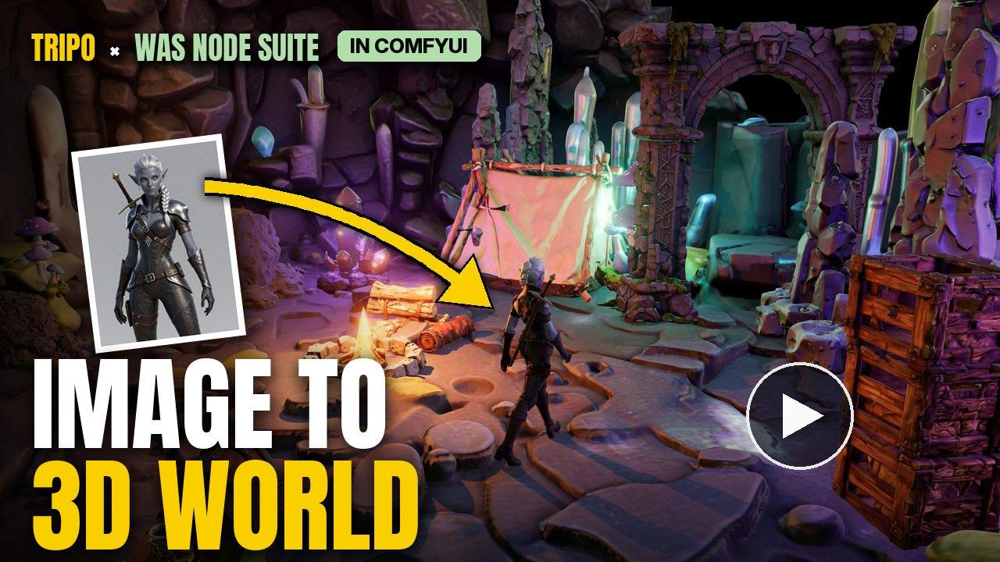

# 3D scenes and Tripo models

The **Three** nodes build a three.js scene inside a graph: geometry, materials, lights, cameras and
models, drawn live on the canvas, rendered to frames with depth and normal maps, path traced, or
written out as a web page that runs on its own. **Three Load Model** takes a model straight from a
3D generator, so a model from Tripo is lit, animated and rendered the moment it arrives.

[Tripo × WAS Node Suite](https://youtu.be/X9laCPGfLLw) shows the Tripo graphs below at work. The 44
nodes are in [`NODES.md`](../NODES.md) under **WAS Suite/Three**, with every input, output and
tooltip.

## A scene

| Node | Takes | Hands on |
|---|---|---|
| A geometry node and a material node | Sizes, colours and maps | A geometry and a material |
| **Three Mesh** | A geometry and a material | An object |
| **Three Load Model** | A model file, or a generator's model | An object |
| **Three Transform Object**, **Three Animate Transform**, **Three Play Animation**, **Three Follow Ground** | An object | The object placed, moving, animated or kept on the ground |
| **Three Group** | Up to eight objects, groups among them | One object |
| **Three Scene** | One root object, an environment and a background | The scene |
| **Three App** | The scene, a camera and a chain of effects | What every viewer and render reads |

| Node | Gives |
|---|---|
| **Three Viewer** | A live view on the node: orbit, frame a shot inside the render's gate, and move objects with a gizmo. With `override` on, the framing and the moves are handed on to the render |
| **Three Path Trace Viewer** | The scene path traced on the node, cleaning up as samples add |
| **Three Render** | Frames, with depth and normal maps |
| **Three Path Trace Render** | Path traced frames, depth and normals, with a `denoise` strength |
| **Three Compile** | A zip holding `index.html`, which draws and orbits the scene with no ComfyUI and nothing fetched over the network |

The viewers and both renders draw in the ComfyUI page. A graph holding a render is queued from an
open ComfyUI tab, and the tab stays open until the render finishes.

## Models from Tripo and other generators

| Three Load Model input | Takes |
|---|---|
| `path` | ComfyUI-Tripo's `model_file`, or Load 3D's `mesh_path` |
| `model_3d` | The 3D file ComfyUI's own Tripo, Hunyuan3D, Meshy, Rodin and Load 3D nodes put out, or a model from the 3D nodes below |
| The menu | A model in `ComfyUI/input` |

Three Load Model reads `.glb`, `.gltf`, `.vrm`, `.dae`, `.fbx`, `.obj`, `.3mf`, `.stl` and `.ply`, and
glTF compressed with meshopt or Draco, and reports what the file holds on the node. The spring bones
of a VRM 1.0 model swing in Three Viewer and Three Render as the model moves. With `keep_as`, it
keeps a copy of the model in `ComfyUI/input`, so the menu still finds it once the generator is
bypassed.

| For | Set |
|---|---|
| Hair, skin or cloth a generator made polished metal | Three Load Model's `metalness` lower and `min_roughness` higher |
| A walk on the spot, carried by a path or a turn | Three Play Animation's `root_motion` on `in place` |
| A clip retargeted from another skeleton standing on flat feet | Three Play Animation's `feet` on `flat when planted` |
| A character walking over uneven ground, such as a terrain or a cave floor | **Three Follow Ground**, with the walker on `object` and the floor model on `ground` |
| A camera that rides with a moving character and turns as it turns | **Three Track**, with `offset_space` on `object` |

 

### Setup for the Tripo graphs

| Needs | Where it goes |
|---|---|
| [ComfyUI-Tripo](https://github.com/VAST-AI-Research/ComfyUI-Tripo) | ComfyUI Manager's Custom Nodes Manager, as **Tripo for ComfyUI**. It needs the `tripo3d` package: `pip install "tripo3d>=1.0.0,<2.0.0"` in the Python ComfyUI runs on |
| A Tripo API key, from [platform.tripo3d.ai](https://platform.tripo3d.ai/) | The environment variable `TRIPO_API_KEY` before ComfyUI starts, or `{"TRIPO_API_KEY": "tsk_..."}` saved as `ComfyUI/custom_nodes/ComfyUI-Tripo/config.json` |
| The `apikey` box on the Tripo nodes | Left empty. Text typed there is saved in the workflow and in the metadata of every picture and video it makes |
| [Venice Sunset](https://polyhaven.com/a/venice_sunset) and [Moonless Golf](https://polyhaven.com/a/moonless_golf), 2K `.hdr` from Poly Haven | `ComfyUI/input`, for the graphs that name them |

A graph queued again calls Tripo only when something feeding a Tripo node has changed, so new
lights, cameras or timing spend no credits.

## 3D models, meshes and characters

The 22 nodes in **WAS Suite/3D/Model**, **WAS Suite/3D/Mesh** and **WAS Suite/3D/Character** hand
one model from node to node: its parts, materials, skeleton, skin, shape keys and clips. Each also
hands on the same model as a core `MESH`, its parts merged and their textures packed into one
atlas.

| Format | 3D Model Load reads | 3D Model Save writes |
|---|---|---|
| `.glb`, `.gltf` | Meshes, materials and textures, skeleton and skin, shape keys, clips, meshopt compression | All of it |
| `.vrm` | VRM 1.0 and 0.x: humanoid bones, expressions, spring bones, MToon materials, metadata | VRM 1.0 from a model with a humanoid skeleton, without clips |
| `.fbx` | Binary and ASCII FBX 7; FBX 6 is refused | Binary FBX 7.4 in centimetres, textures inside or beside it, without clips |
| `.obj` | Polygons, `.mtl` materials and their textures | Mesh, materials and textures |

| Limit | Value |
|---|---|
| A model file 3D Model Load reads | 512 MB |
| One texture | 8192 x 8192 pixels |
| A picture Mesh Render Views renders | 4096 x 4096 pixels |
| A file a model names beside itself, such as a texture | 256 MB, in a folder the pack may read |

| For | Set |
|---|---|
| A head on a body, both from a generator | **Character Assemble**, the body on `body` and the head on `head` |
| A head that joins the body cleanly | The body generated bald, and the head generated as a head and long bare neck with no shoulders |
| The new head's skin toned to the body's | Character Assemble's `skin_match` on `head to body` |
| A head made facing another way from the body | Character Assemble's `head_turn` |
| The body's own hair left hanging below the new head | Character Assemble's `clear_body_hair` on `auto` |
| Hair or skin that renders like polished metal | **3D Model Material** on those parts, `metalness` low and `min_roughness` 0.5 |
| A model for Tripo's **Import model** | 3D Model Save's `folder` on `input`, a `filename_prefix` without a folder, and `filename` wired to `model_file` |
| A VRM avatar from a Tripo rig | Tripo **Rig model** with `spec` on `vrm`, then 3D Model Load's `scale_to_height` and `face_forward` |
| A VRM avatar rigged locally, with no credits | **Character Rig**, then **3D Model Save** on `vrm` |
| Fingers that curl | Character Rig's `fingers` on |
| Eyes that follow a target in VRM viewers | Character Rig's `eyes` on; eyeball parts turn, painted eyes set where the gaze comes from |
| A neck seam that stays shut when the head turns | **Character Neck Join** after Character Rig |
| Head and body as one part | Character Neck Join's `merge_parts` on, after Character Rig and Character Springs |
| Hair that swings in VRM viewers and games | **Character Springs** after the rig, then 3D Model Save on `vrm` |
| Hair that swings in a Three scene | Character Springs into Three Load Model's `model_3d`, moved by **Three Animate Transform** or **Three Play Animation** |
| A stiff braid that still sways | Character Springs' `stiffness` 2.0 and `gravity` 0.1 |
| A skirt or cape that swings | The skirt or cape as its own part, from the generator or split off with **3D Model Parts** or **Mesh Cut**, labelled `skirt` or `cape`, then Character Springs |
| A dense generated model made light | **Mesh Clean**, then **Mesh Decimate** with `target` on `triangles` |
| A quad model with the original's look | **Mesh Retopology**, **Mesh UV Unwrap**, then **Mesh Bake Textures** with the original on `source` |
| A texture enhanced or repainted by an image model | **Mesh Render Views**, the image model on `images`, then **Mesh Project Views** with the same `views` and the edited pictures |
| A texture upscaled and given real surface detail | Mesh Render Views at 1024; each picture, one at a time through Rebatch Images, as `<Picture 1>` on MiniMax H3 Image Conditioning at 8192 x 8192 with a prompt naming every colour as it is and the materials as matte; the result scaled to 4096 and batched again; Mesh Project Views with `texture_size` 4096 |
| Highlights and shadows taken out of the new texture | **Image Delight** on the enhanced pictures before Mesh Project Views, Power Preprocessor's `albedo` of the same pictures on `albedo`, Mesh Render Views' `masks` on `mask` and `colour` on `image` |
| Roughness read off the pictures | Power Preprocessor on `roughness` with `Marigold IID Appearance`, into Mesh Project Views with `map` on `roughness` |
| A normal map read off the pictures | Power Preprocessor on `normal_map` with `Marigold v2`, into Mesh Project Views with `map` on `normal` |
| Several maps on one model | One Mesh Project Views per map, each taking the last one's `model_3d` and the same `views` |
| A model that renders as metal everywhere | **3D Model Material** with `metalness` 0 before Mesh Project Views, and no metallic map projected |
| A model without texture coordinates projected onto | **Mesh UV Unwrap** before Mesh Project Views |
| Depth or normal pictures for a ControlNet | Mesh Render Views' `depth` and `normals` |

## Graphs

| Graph | Makes |
|---|---|
| [`three-scene.json`](workflows/three-scene.json) | Every node in **WAS Suite/Three** in one scene, drawn, rendered and compiled |
| [`three-environment.json`](workflows/three-environment.json) | A mirror, brushed metal, painted metal and clear glaze sphere lit by an environment |
| [`three-path-tracing.json`](workflows/three-path-tracing.json) | Boxes and spheres under an area light, path traced on the node and rendered |
| [`three-skinned-model.json`](workflows/three-skinned-model.json) | A rigged `.dae` model playing its own animation. It reads `stormtrooper.dae` and `Stormtrooper_D.jpg` from `ComfyUI/input`, both in the three.js repository under `examples/models/collada/stormtrooper/` |
| [`three-camera-track.json`](workflows/three-camera-track.json) | A camera locked on a walking model carried around a turntable |
| [`tripo-turntable.json`](workflows/tripo-turntable.json) | A Tripo model on a studio floor, a seamless 6 second turntable video and a path traced hero still |
| [`tripo-hdri-showcase.json`](workflows/tripo-hdri-showcase.json) | A Tripo model on a turntable plinth inside an HDRI panorama, path traced with denoising |
| [`tripo-character-walk.json`](workflows/tripo-character-walk.json) | Z-Image Turbo concept art, made into a rigged Tripo character walking on a turntable |
| [`tripo-render-to-art.json`](workflows/tripo-render-to-art.json) | A Tripo model's depth pass painted in three styles through Z-Image's Fun ControlNet |
| [`tripo-reference-sheet.json`](workflows/tripo-reference-sheet.json) | Eight views of a Tripo model as colour, depth and normal sheets |
| [`tripo-drow-turntable.json`](workflows/tripo-drow-turntable.json) | A drow adventurer from a prompt: concept art, a Tripo model and a path traced HDRI turntable, each stage a subgraph |
| [`tripo-cave-asset-kit.json`](workflows/tripo-cave-asset-kit.json) | Twelve cave camp props from Tripo text to 3D, kept for the scene and rendered as a lineup |
| [`tripo-drow-scene.json`](workflows/tripo-drow-scene.json) | The drow rigged and walking through the cave camp, filmed by a wide and a chase camera |
| [`tripo-character-vrm.json`](workflows/tripo-character-vrm.json) | A head drawn by Z-Image and a body generated apart by Tripo, assembled, rigged with the VRM skeleton by Tripo and locally, given hair springs, played in a Three scene and saved as VRM avatars and GLBs |
| [`3d-upscale-textures.json`](workflows/3d-upscale-textures.json) | A model's six projections each redrawn by MiniMax H3 Image at 67 megapixels from the projection itself and scaled to 4096, delit by Image Delight, read for roughness by Marigold IID Appearance and for surface direction by Marigold v2, recompiled into its base colour, roughness and normal maps with its metalness at 0, and shown in Preview 3D beside the original. Any model 3D Model Load reads works; the graph names `tripo_assets/drow_adventurer.glb` |

## Configuration

| Key | Default | Does |
|---|---|---|
| `features.threejs` | `true` | Loads the 44 Three nodes. `false` leaves them out |
| `threejs.allow_scripts` | `false` | Lets a scene carry javascript from **Three Custom Geometry**, **Three Custom Material**, **Three Custom Object**, **Three Custom Update** or **Three Script Module**. Left `false`, such a scene is refused by the node that would draw it |

Both keys are in [`CONFIG.md`](CONFIG.md#threejs). three.js and three-gpu-pathtracer ship with the
pack, and the browser fetches them only when a scene runs.

## Troubleshooting

| What happens | Cause | Fix |
|---|---|---|
| A render waits and then times out | No ComfyUI tab is open to draw it | Queue the graph from an open ComfyUI tab and keep the tab open |
| A scene is refused, and the node names a Custom or Script Module node | `threejs.allow_scripts` is off | Set it to `true` in `config.yaml` for a workflow written or read first |
| A polished dark material renders almost black | Nothing for it to reflect | Wire a **Three Environment** into **Three Scene** |
| Hair or skin renders as polished metal | The generator marked it metallic | Lower Three Load Model's `metalness` and raise `min_roughness` |
| A walking character jumps back at the end of every cycle | Three Play Animation's `root_motion` is `as authored` | `in place` with a path or a turn, or `travel` to walk on |
| A standing foot points toe-up | The clip was made on a skeleton with other feet, such as heeled boots | Three Play Animation's `feet` on `flat when planted` |
| A character floats over dips or sinks into rocks | It walks a flat path over uneven ground | **Three Follow Ground**, with the floor model on `ground` |
| An HDRI background is a smear of colour | Three Environment's `background_blur` is 0.15 or more | `0.05` for a slightly soft, readable background, `0` for a sharp one |
| Tripo nodes stop with `TRIPO API key is required` | ComfyUI started without the key | Set `TRIPO_API_KEY` before starting ComfyUI, or save ComfyUI-Tripo's `config.json` |
| Firefox pauses the tab on the first path traced frame of a page | Firefox compiles the tracer once per page | Later frames on the same page start at once |
| Character Assemble sets the new head on top of the body's own head | No neck was found on the body | `remove_body_head` on `yes`, or `head_fit` on `keep` with the head placed by `placement` |
| Tripo's **Import model** menu does not list a saved model | The menu lists only files directly in `ComfyUI/input` | 3D Model Save's `folder` on `input` and a `filename_prefix` without a folder |
| 3D Model Save refuses a VRM and names missing bones | The model has no humanoid skeleton | Rig it first, with Tripo **Rig model** on `spec` `vrm` |
| An avatar from a Tripo rig stands 1 m tall | Tripo returns a rigged model 1 m tall | 3D Model Load's `scale_to_height` |
| Character Rig stops on the legs | The legs do not separate below the hips, as under a long skirt or robe | Rig it with Tripo **Rig model** |
| Character Rig stops on an arm | The arm touches the body along its length | Generate the character in a T-pose or an A-pose with the arms clear of the body |
| Mesh Symmetrize mirrors the front onto the back | `axis` on `X` for a model facing +X | `axis` on `auto`, or `Z` |
| Some of the body's own hair stays below the new head | Its colour differs from the hair on the crown, or matches the clothes | Generate the body with short or tied-up hair |
| A new head looks too small or too large on a body generated without one | The head is sized by its neck, and a generated head's neck is often thicker or thinner than the body's | Generate the body with a bald head of its own, or set `head_scale` |
| Character Assemble's report notes the head's neck ends above the body's | The head was generated with a short neck | Generate the head with a long bare neck |
| Long hair passes into the body's back or shoulders | Hair is kept whole | **Character Springs** with `colliders` on, or generate the head with its hair worn up or short |
| A hood or high collar is cut flat at the neck | It is joined to the body's own neck above the seam | Generate the body with the hood down or the collar clear of the neck |
| Character Rig turns the character to face away | Its facing was read wrongly from the feet | Character Rig's `facing` on the way the character faces as loaded |
| Creases in the throat under the new head | The body's own jaw reached below its neck ring, and was drawn in to meet the new neck | Generate the body bald with a clear neck under the jaw |
| The new head's skin is a different tone from the body's | `skin_match` is `off`, or the report notes the body's skin could not be read | `skin_match` on `head to body`, with skin showing at the body's neck or face |
| Mesh Retopology leaves a small hole on a skirt or cape | The flap is thinner than the new faces, and its two sides fall on one face | Raise `target_faces` |
| Character Springs makes no chains | No hair hangs below the head joint, or it was not found by colour | Label the hair part `hair` with **3D Model Parts** and set `hair` on `hair parts` |
| Hair passes through the shoulders when it swings | Colliders are off, or the arms sit far from the body | `colliders` on |
| Character Springs leaves a skirt still | The skirt is fused into the body rather than a part of its own | Split it off and label it `skirt`, or name its part in `cloth` |
| The legs drag a swinging skirt with them | The skirt part also holds leg surface | Split the skirt off more tightly |
| Part of a strand stays put while the rest swings | That part sits above the head joint and moves with the head | Expected for hair on the scalp; long hair swings from below the jaw |
| Mesh Project Views stops on the picture count | The pictures are not one per camera, in render order | Wire the edited `images` batch whole, as Mesh Render Views made it |
| The background's colour shows at the model's edges | The image model blurred the background into the outline | Raise `outline_fade` |
| A thin part takes colour from what lies behind it | `depth_tolerance` reaches past the part's thickness | Lower `depth_tolerance` |
| Seams where two pictures meet on the model | The pictures disagree there | Raise `falloff`, or keep the image model's seed and prompt the same for every picture |
| A detail the model does not have, such as a lock of hair over a cheek | The image model drew it in one picture | Lower the sampler's `denoise`, or wire `masks` that leave that region out of the pictures |
| Gloss, highlights or shading baked into the new texture | The image model draws light whatever the prompt asks | **Image Delight** on the pictures before Mesh Project Views |
| Image Delight shifts the colours | `colour` on `albedo` takes the estimate's hues | `colour` on `image` |
| Soft fold shading left after Image Delight | `detail` is high | Lower `detail`; 16 suits 4096 pictures |
| Leather, skin or cloth projected as metal | Power Preprocessor's `metallicity` reads glossy surfaces as metal | Leave the metallic map unprojected, with 3D Model Material's `metalness` at 0 |
| A normal map with seams between views | The read normals disagree with the mesh across views | Raise Mesh Project Views' `falloff` |
| A colour on the new texture differs from the model's | The prompt names another colour, such as black for charcoal olive | Name every colour as it is in the picture |
| Part of the model keeps its old colours | No picture sees it, such as under the arms | Add cameras with `around`, or a second Render and Project pass with other views |
| The new head sits off the body's shoulders | The body has no head of its own to fit it over | Generate the body with a bald head, or move the head with `placement` |
| Character Neck Join stops on the head | The head was not joined by Character Assemble, or the model was decimated or reshaped after it | Run Character Neck Join straight after Assemble or Rig |
| The neck seam opens when the head turns | Character Neck Join ran before Character Rig | Character Neck Join after Character Rig |