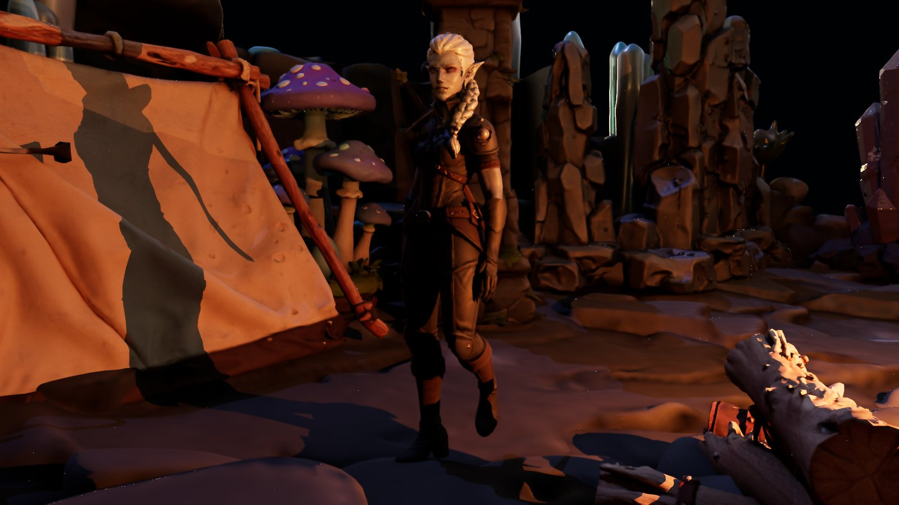
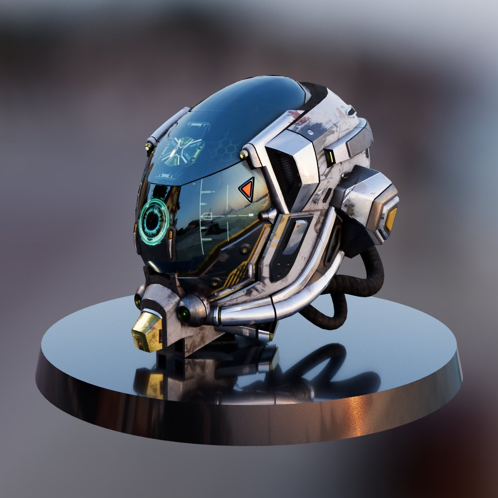
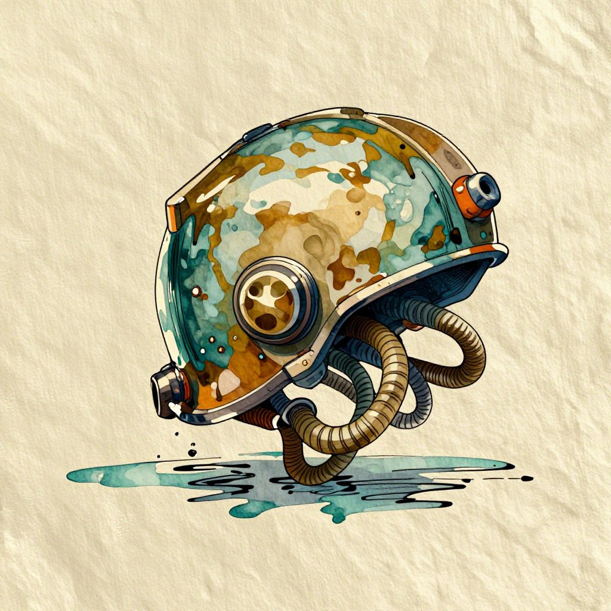
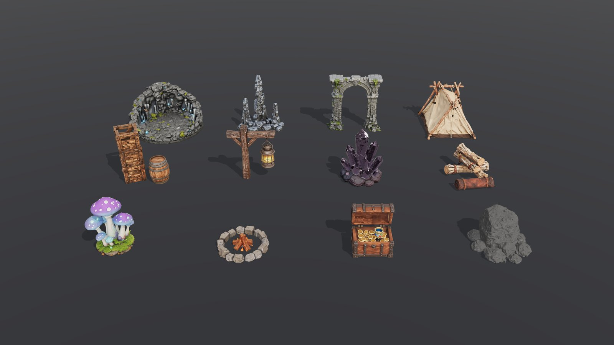
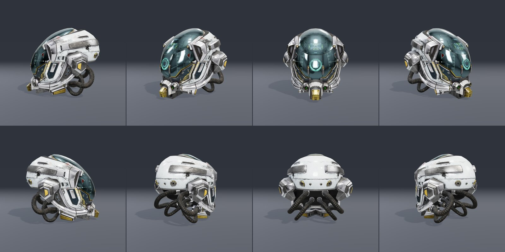

# 3D scenes and Tripo models

The **Three** nodes build a three.js scene inside a graph: geometry, materials, lights, cameras and
models, drawn live on the canvas, rendered to frames with depth and normal maps, path traced, or
written out as a web page that runs on its own. **Three Load Model** takes a model straight from a
3D generator, so a model from Tripo is lit, animated and rendered the moment it arrives.

[Tripo × WAS Node Suite](https://youtu.be/X9laCPGfLLw) shows the Tripo graphs below at work. The 44
nodes are in [`NODES.md`](../NODES.md) under **WAS Suite/Three**, with every input, output and
tooltip.

## A scene

| Node | Takes | Hands on |
|---|---|---|
| A geometry node and a material node | Sizes, colours and maps | A geometry and a material |
| **Three Mesh** | A geometry and a material | An object |
| **Three Load Model** | A model file, or a generator's model | An object |
| **Three Transform Object**, **Three Animate Transform**, **Three Play Animation**, **Three Follow Ground** | An object | The object placed, moving, animated or kept on the ground |
| **Three Group** | Up to eight objects, groups among them | One object |
| **Three Scene** | One root object, an environment and a background | The scene |
| **Three App** | The scene, a camera and a chain of effects | What every viewer and render reads |

| Node | Gives |
|---|---|
| **Three Viewer** | A live view on the node: orbit, frame a shot inside the render's gate, and move objects with a gizmo. With `override` on, the framing and the moves are handed on to the render |
| **Three Path Trace Viewer** | The scene path traced on the node, cleaning up as samples add |
| **Three Render** | Frames, with depth and normal maps |
| **Three Path Trace Render** | Path traced frames, depth and normals, with a `denoise` strength |
| **Three Compile** | A zip holding `index.html`, which draws and orbits the scene with no ComfyUI and nothing fetched over the network |

The viewers and both renders draw in the ComfyUI page. A graph holding a render is queued from an
open ComfyUI tab, and the tab stays open until the render finishes.

## Models from Tripo and other generators

| Three Load Model input | Takes |
|---|---|
| `path` | ComfyUI-Tripo's `model_file`, or Load 3D's `mesh_path` |
| `model_3d` | The 3D file ComfyUI's own Tripo, Hunyuan3D, Meshy, Rodin and Load 3D nodes put out |
| The menu | A model in `ComfyUI/input` |

Three Load Model reads `.glb`, `.gltf`, `.dae`, `.fbx`, `.obj`, `.3mf`, `.stl` and `.ply`, and glTF
compressed with meshopt or Draco, and reports what the file holds on the node. With `keep_as`, it
keeps a copy of the model in `ComfyUI/input`, so the menu still finds it once the generator is
bypassed.

| For | Set |
|---|---|
| Hair, skin or cloth a generator made polished metal | Three Load Model's `metalness` lower and `min_roughness` higher |
| A walk on the spot, carried by a path or a turn | Three Play Animation's `root_motion` on `in place` |
| A clip retargeted from another skeleton standing on flat feet | Three Play Animation's `feet` on `flat when planted` |
| A character walking over uneven ground, such as a terrain or a cave floor | **Three Follow Ground**, with the walker on `object` and the floor model on `ground` |
| A camera that rides with a moving character and turns as it turns | **Three Track**, with `offset_space` on `object` |

 

### Setup for the Tripo graphs

| Needs | Where it goes |
|---|---|
| [ComfyUI-Tripo](https://github.com/VAST-AI-Research/ComfyUI-Tripo) | ComfyUI Manager's Custom Nodes Manager, as **Tripo for ComfyUI**. It needs the `tripo3d` package: `pip install "tripo3d>=1.0.0,<2.0.0"` in the Python ComfyUI runs on |
| A Tripo API key, from [platform.tripo3d.ai](https://platform.tripo3d.ai/) | The environment variable `TRIPO_API_KEY` before ComfyUI starts, or `{"TRIPO_API_KEY": "tsk_..."}` saved as `ComfyUI/custom_nodes/ComfyUI-Tripo/config.json` |
| The `apikey` box on the Tripo nodes | Left empty. Text typed there is saved in the workflow and in the metadata of every picture and video it makes |
| [Venice Sunset](https://polyhaven.com/a/venice_sunset) and [Moonless Golf](https://polyhaven.com/a/moonless_golf), 2K `.hdr` from Poly Haven | `ComfyUI/input`, for the graphs that name them |

A graph queued again calls Tripo only when something feeding a Tripo node has changed, so new
lights, cameras or timing spend no credits.

## Graphs

| Graph | Makes |
|---|---|
| [`three-scene.json`](workflows/three-scene.json) | Every node in **WAS Suite/Three** in one scene, drawn, rendered and compiled |
| [`three-environment.json`](workflows/three-environment.json) | A mirror, brushed metal, painted metal and clear glaze sphere lit by an environment |
| [`three-path-tracing.json`](workflows/three-path-tracing.json) | Boxes and spheres under an area light, path traced on the node and rendered |
| [`three-skinned-model.json`](workflows/three-skinned-model.json) | A rigged `.dae` model playing its own animation. It reads `stormtrooper.dae` and `Stormtrooper_D.jpg` from `ComfyUI/input`, both in the three.js repository under `examples/models/collada/stormtrooper/` |
| [`three-camera-track.json`](workflows/three-camera-track.json) | A camera locked on a walking model carried around a turntable |
| [`tripo-turntable.json`](workflows/tripo-turntable.json) | A Tripo model on a studio floor, a seamless 6 second turntable video and a path traced hero still |
| [`tripo-hdri-showcase.json`](workflows/tripo-hdri-showcase.json) | A Tripo model on a turntable plinth inside an HDRI panorama, path traced with denoising |
| [`tripo-character-walk.json`](workflows/tripo-character-walk.json) | Z-Image Turbo concept art, made into a rigged Tripo character walking on a turntable |
| [`tripo-render-to-art.json`](workflows/tripo-render-to-art.json) | A Tripo model's depth pass painted in three styles through Z-Image's Fun ControlNet |
| [`tripo-reference-sheet.json`](workflows/tripo-reference-sheet.json) | Eight views of a Tripo model as colour, depth and normal sheets |
| [`tripo-drow-turntable.json`](workflows/tripo-drow-turntable.json) | A drow adventurer from a prompt: concept art, a Tripo model and a path traced HDRI turntable, each stage a subgraph |
| [`tripo-cave-asset-kit.json`](workflows/tripo-cave-asset-kit.json) | Twelve cave camp props from Tripo text to 3D, kept for the scene and rendered as a lineup |
| [`tripo-drow-scene.json`](workflows/tripo-drow-scene.json) | The drow rigged and walking through the cave camp, filmed by a wide and a chase camera |

## Configuration

| Key | Default | Does |
|---|---|---|
| `features.threejs` | `true` | Loads the 44 Three nodes. `false` leaves them out |
| `threejs.allow_scripts` | `false` | Lets a scene carry javascript from **Three Custom Geometry**, **Three Custom Material**, **Three Custom Object**, **Three Custom Update** or **Three Script Module**. Left `false`, such a scene is refused by the node that would draw it |

Both keys are in [`CONFIG.md`](CONFIG.md#threejs). three.js and three-gpu-pathtracer ship with the
pack, and the browser fetches them only when a scene runs.

## Troubleshooting

| What happens | Cause | Fix |
|---|---|---|
| A render waits and then times out | No ComfyUI tab is open to draw it | Queue the graph from an open ComfyUI tab and keep the tab open |
| A scene is refused, and the node names a Custom or Script Module node | `threejs.allow_scripts` is off | Set it to `true` in `config.yaml` for a workflow written or read first |
| A polished dark material renders almost black | Nothing for it to reflect | Wire a **Three Environment** into **Three Scene** |
| Hair or skin renders as polished metal | The generator marked it metallic | Lower Three Load Model's `metalness` and raise `min_roughness` |
| A walking character jumps back at the end of every cycle | Three Play Animation's `root_motion` is `as authored` | `in place` with a path or a turn, or `travel` to walk on |
| A standing foot points toe-up | The clip was made on a skeleton with other feet, such as heeled boots | Three Play Animation's `feet` on `flat when planted` |
| A character floats over dips or sinks into rocks | It walks a flat path over uneven ground | **Three Follow Ground**, with the floor model on `ground` |
| An HDRI background is a smear of colour | Three Environment's `background_blur` is 0.15 or more | `0.05` for a slightly soft, readable background, `0` for a sharp one |
| Tripo nodes stop with `TRIPO API key is required` | ComfyUI started without the key | Set `TRIPO_API_KEY` before starting ComfyUI, or save ComfyUI-Tripo's `config.json` |
| Firefox pauses the tab on the first path traced frame of a page | Firefox compiles the tracer once per page | Later frames on the same page start at once |
