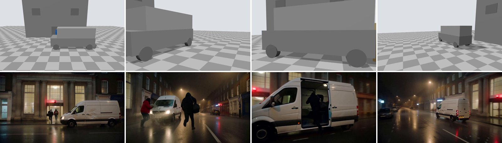
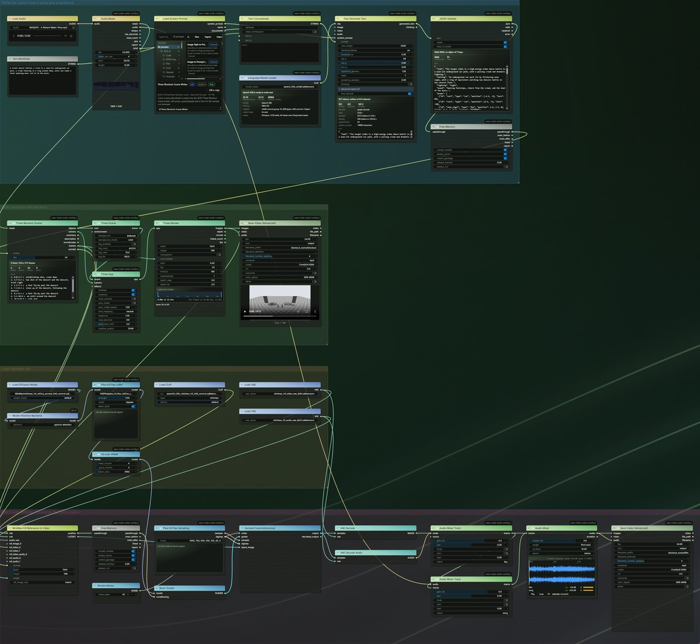
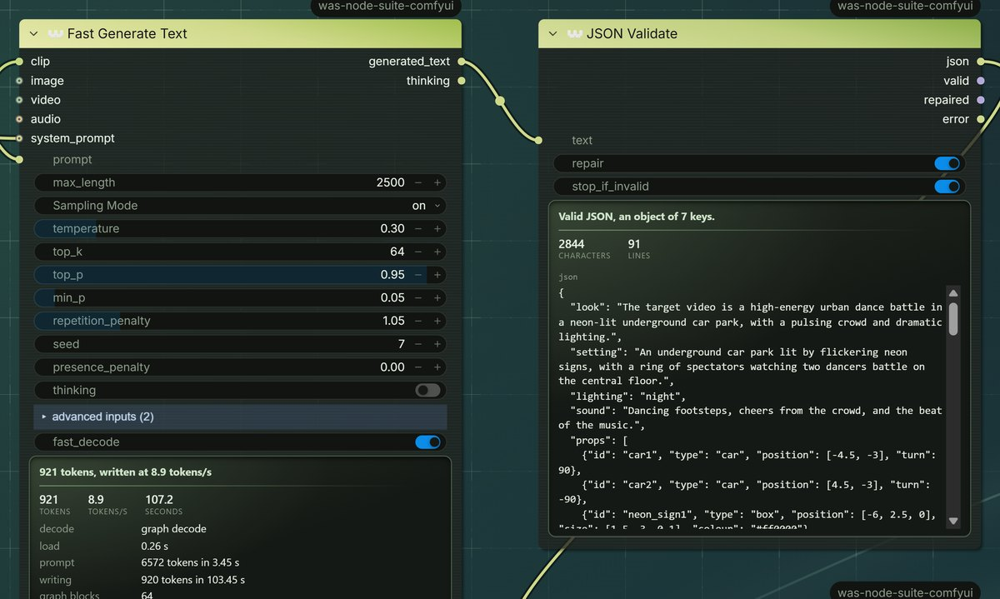
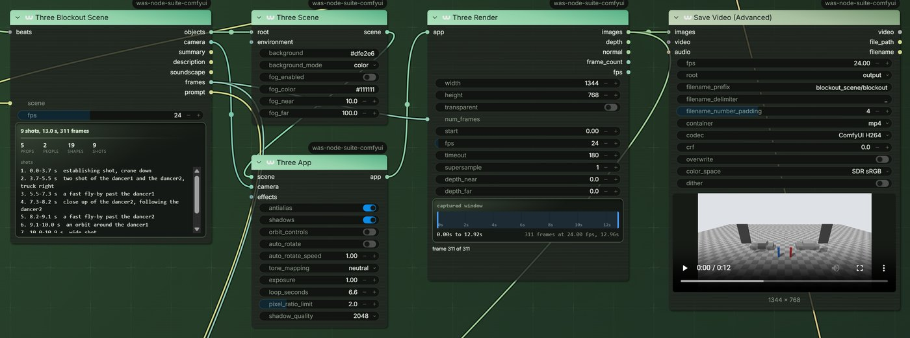
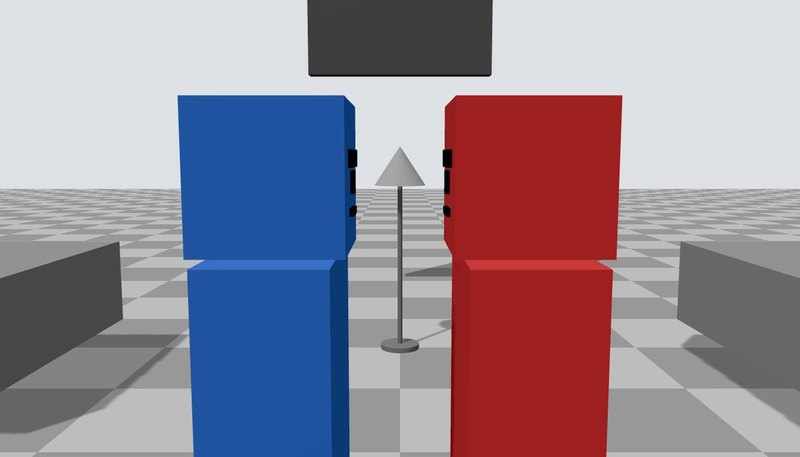
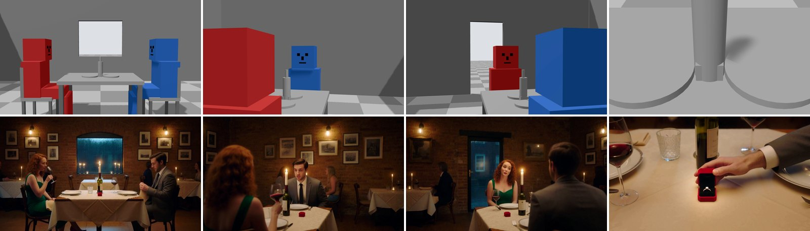
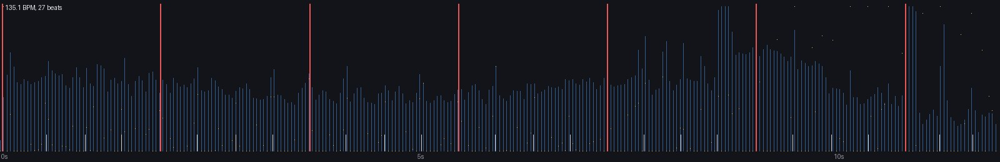
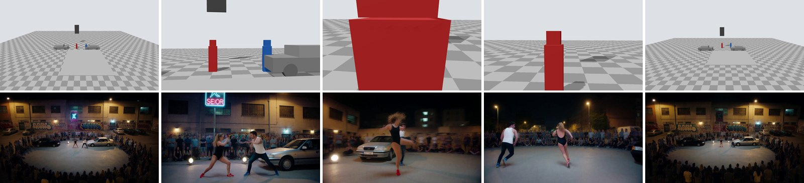
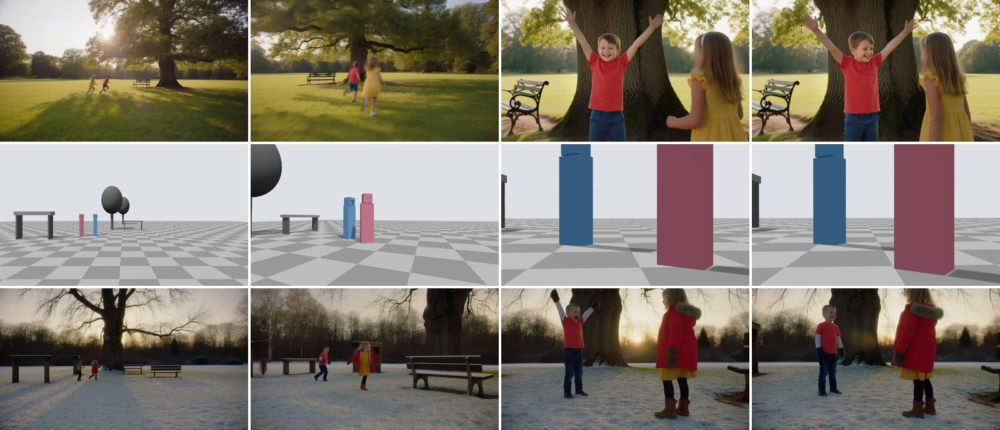
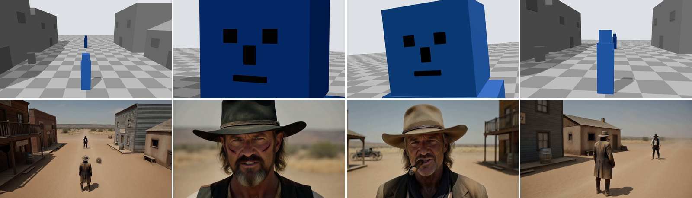

# Blockout scenes

**Three Blockout Scene** builds a grey-box scene from a JSON description: props, people, their
motion, and a list of shots the camera cuts between. It also writes the matching MiniMax H3 prompt,
one `[Shot N]` line per shot. The scene goes to **Three Render** and on to **MiniMax H3 Reference to
Video** as `<Video 1>`, which films it as live action with every block replaced by the real thing. The
JSON is written by hand or by a language model through the built-in **Three Blockout Scene Writer**
skill.



Every input, output and tooltip is in [`NODES.md`](../NODES.md) under **WAS Suite/Three**.

## The chain



[`blockout-scene-film.json`](workflows/blockout-scene-film.json) runs the whole chain from a song and one
sentence.

| Stage | Node | Hands on |
|---|---|---|
| Listen | **Load Audio** and **Audio Beats**, optional | `brief`, the song as text, joined onto the request; `beats` for Three Blockout Scene |
| Write | **Load System Prompt** set to `Built-in/Three/three-blockout-scene/SKILL.md`, a language model loader and **Fast Generate Text**, given a sentence | The scene as JSON |
| Check | **JSON Validate**, `repair` on | The JSON, mended where a model broke it |
| Build | **Three Blockout Scene** | `objects`, `camera`, `summary`, `description`, `soundscape`, `frames` |
| Draw | **Three Scene**, **Three App**, **Three Render** with `num_frames` from `frames` | The grey box with every cut and move |
| Film | **MiniMax H3 Reference to Video** with the render on `ref_video_0`, `prompt` from `prompt` and `length` from `frames`; the ref2va model through Pika H3 Flex LoRA (`bypass`) and H3 Low VRAM, Pika H3 Flex Sampling's sampler and sigmas, Free Memory between the prompt and the sampler | The finished film, with its sound |



The Write and Check stages: the model's scene as JSON, and JSON Validate's readout of it.



The Build and Draw stages: Three Blockout Scene lists every shot with its time and framing, Three
Render's strip shows the frames it captures, and the grey box plays on Save Video.

| Language model | Loader | Writes with |
|---|---|---|
| Qwen3 32B `qwen3_32b_w4a8.safetensors`, local, about a minute per scene on a 24 GB card | **Language Model Loader** | **Fast Generate Text** |
| A GGUF model, such as gpt-oss or DeepSeek | **LLM Loader** | **LLM Complete**, `system_prompt` wired from Load System Prompt |
| Anthropic, OpenAI and the other providers | **LLM Anthropic**, **LLM OpenAI**, **LLM Provider** | **LLM Complete** |

The LLM family needs `features.llm` on; see [`LLM.md`](LLM.md).

MiniMax H3's own Qwen3-VL 32B encoder has no output layer and writes no text.

## The scene

Metres, `y` up. The camera starts on the `+z` side looking toward `-z`, so `-x` is screen left. A
thing's own front is its `+z`.

| Key | Holds |
|---|---|
| `setting` | One sentence about the place, for the H3 prompt |
| `look` | The film's look, beginning `The target video is ...`, for the H3 prompt |
| `sound` | What is heard, for the H3 soundscape |
| `music` | The score, for the H3 music |
| `set_picture` | The number of a reference picture of the location, `<Picture N>` on MiniMax H3 Reference to Video; the location is kept as pictured and a `room` takes its look |
| `lighting` | `day`, `evening`, `night` or `studio`, for the H3 prompt; the block-out is lit bright and even for all four |
| `floor` | `false` removes the checkerboard floor |
| `figures` | `block`, the default: each person a box body and a cube head with a face; `jointed`: a figure with swinging limbs |
| `tempo` | Beats per minute, 40 to 240, for shots measured in `beats` |
| `kinds` | Props built from shapes, named for reuse |
| `props` | The set |
| `people` | The cast |
| `shots` | The camera, shot by shot |

| Limit | Value |
|---|---|
| Text | 64 KB, nested 12 deep |
| Props | 150, counts expanded |
| Shapes | 2000 in all, 64 in one built prop, 24 kinds |
| People | 12 |
| Shots | 24, 60 seconds in all, 0.5 to 20 seconds each |
| Motion | 8 steps per prop or person |
| Camera keys | 16 per shot |

A key the format does not hold, a type, rig or move it does not know, or a reference to an id that
does not exist is refused, and the refusal lists every problem with the values allowed.

## Props

| Type | Anchors |
|---|---|
| `table`, `desk` | `front`, `back`, `left`, `right`, `center`, `top` |
| `chair` | `seat`, `front` |
| `stool` | `seat` |
| `sofa` | `seat_left`, `seat_middle`, `seat_right`, `front` |
| `bench` | `seat_left`, `seat_right`, `front` |
| `bed` | `front`, `back`, `left`, `right`, `foot`, `top`, `pillow` |
| `car`, `van`, `truck`, `bus` | `front`, `back`, `left`, `right`, `driver`, `passenger` |
| `bicycle` | `left`, `right`, `seat` |
| `door`, `window`, `wall`, `wall_with_window`, `wall_with_door` | `front`, `back` |
| `building`, `house` | `front`, `back`, `left`, `right`, `door` |
| `room` | `back`, `front`, `left`, `right`, `window`, `door`, `center`, inside and facing in |
| `tree` | `front`, `back`, `left`, `right` |
| `bush`, `lamp`, `plate`, `bowl`, `cup`, `glass`, `bottle`, `food`, `book`, `laptop`, `crate`, `box` | `center`, `top` |
| Shapes: `box`, `cylinder`, `sphere`, `cone`, `capsule`, `ramp`, `stairs`, `arch`, `ground` | `front`, `back`, `left`, `right`, `center`, `top` |

Every type has `center` and `top`. An anchor on a side faces what it belongs to.

| Key | Does |
|---|---|
| `id` | Lower case letters, digits and `_`, starting with a letter |
| `type` | A type above, or a name under `kinds` |
| `position` | `[x, z]` on the floor, or `[x, y, z]` |
| `at` | Stands at an anchor, facing what it belongs to: `"table.left"` |
| `on` | Sits on top of a prop: `"table"` |
| `beside` | Stands next to something, `side` `left`, `right`, `front` or `behind` |
| `against` | Its back to the front of a wall or prop, facing the same way |
| `held_by` | Carried in a person's hands |
| `facing` | Turns toward an id |
| `turn` | Degrees about up; 90 faces `+x` |
| `size` | `[width, height, depth]` |
| `description` | What the real thing is, for the H3 prompt; a real one of its type when left out |
| `picture` | The number of a reference picture of this exact object, `<Picture N>`; kept as pictured |
| `track` | An object Video Blueprint measured, `O1`: its place |
| `colour` | `#rrggbb`, drawn as the grey of its brightness, between 42% and 85% |
| `count` | Copies side by side, named `id_1`, `id_2` |
| `steps` | Steps on `stairs` |
| `parts` | Shapes making the prop, each `shape`, `size`, `position` of its centre and `rotate` in degrees |
| `motion` | Where it goes and when |
| `overlap` | `true` lets it pass into other props |

## The set's layout

| Rule | What happens |
|---|---|
| Interiors | One `room`: four walls, a window at the back, a door on the left, 6 by 2.8 by 5 m unless sized; the camera stays inside |
| Exteriors | `building` and `house` blocks, the rest of the place given in `setting` |
| Loose walls | `wall`, `window`, `door` and the walls with openings are not drawn; they mark places to walk to or stand against |
| Nothing overlaps | Props and standing people that would intersect are moved apart, unless one has `"overlap": true` |
| Clear floor | Anything given no place is set down in clear space near the middle |
| A seat | `sit_on` a table, or one of its sides, sets a chair there |

## People

| Key | Does |
|---|---|
| `name` | What the prompt calls them; the id in title case when left out |
| `gender` | `man`, `woman`, `boy`, `girl`, `child` or `person`; read from `name` and `description` when left out |
| `description` | How they look, for the H3 prompt |
| `pose` | `stand`, `sit`, `walk`, `run`, `point` or `wave` |
| `sit_on` | A chair, stool, sofa, bench, bed or bicycle; a sofa or bench gives the next free seat |
| `look_at` | Turns them toward an id, or only their head when seated |
| `holding` | Props they carry |
| `height` | Metres, 0.5 to 2.5; 1.75 when left out |
| `voice` | How they sound, given with their first line |
| `picture` | The number of a reference picture of this person, `<Picture N>`; face, hair and build kept, the outfit from `description` |
| `keep_outfit` | `true` keeps the outfit in the picture too |
| `track` | A person Video Blueprint measured, `P1`: their place, facing, path and pace |
| `motion` | Where they walk and when |

A person has a face, so the way they face reads in the grey box. Props are grey and people are coloured by
`gender`, and the H3 prompt names each person's colour. A person's `colour` replaces it. Someone posed `walk`
or `run` with no `motion` walks toward what they face.

| `gender` | First | Second | Third |
|---|---|---|---|
| `man` | Blue | Navy | Sky blue |
| `woman` | Red | Dark red | Coral |
| `boy` | Light blue | Teal | Pale blue |
| `girl` | Pink | Magenta | Pale pink |
| `child` | Yellow | Amber | Pale yellow |
| `person` | Tan | Brown | Beige |



## Motion

```
"motion": [{"to": "car.passenger", "start": 4.5, "end": 7}]
```

| Key | Holds |
|---|---|
| `to` | An id, an `id.anchor` or `[x, z]` |
| `start`, `end` | Seconds from the start of the first shot |

A person walks, legs and arms swinging, and runs when the pace is fast; a prop glides. A
destination on something that moves is met where it is when the step ends. A step running past the
last shot ends with it.

| Pace | Metres a second |
|---|--:|
| Walking | 1.3 |
| Hurrying | 2 |
| Running | 3 to 5 |
| A car arriving | 3 to 8 |

## Shots



| Key | Holds |
|---|---|
| `seconds` | 0.5 to 20 |
| `beats` | Length in beats, in place of `seconds`: on the song when `beats` is wired, else at the scene's `tempo` |
| `rig` | The framing |
| `subjects`, `from`, `onto`, `through` | Who or what the rig frames |
| `move` | A camera move during the shot |
| `amount` | How far the move goes: metres, degrees, or the lens in mm for a zoom |
| `ease` | How the move speeds up and slows |
| `shake` | `light`, `handheld`, `heavy` or `impact`; left out, every move is smooth |
| `look_at` | A point the camera stays locked on as it moves: `"anna.face"` |
| `follow` | An id the camera travels with |
| `lens` | Millimetres, 12 to 300 |
| `angle` | Degrees the camera swings around its subject |
| `side` | `front` or `back` of the line between two people |
| `position`, `target` | `[x, y, z]` in place of the rig's framing |
| `keys` | The camera's own path |
| `action` | What happens, for the H3 prompt |
| `dialogue` | Lines spoken in the shot, each `{"who": id, "line": "..."}`, up to 6 |
| `sounds` | Sounds heard at a moment, each `{"at": seconds into the shot, "sound": "..."}`, up to 8; written into the shot's description and listed after `sound` in the soundscape |

| `rig` | The camera |
|---|---|
| `wide` | Everything named, or the whole set |
| `establishing` | Wider and higher |
| `two shot` | Two people side on to the line between them |
| `over the shoulder` | Past `from`'s shoulder onto `onto`, kept on one side of the line |
| `medium` | `onto` from the chest up |
| `close up` | `onto`'s face |
| `insert` | A close look at a prop, from above |
| `top down` | Straight down on the set |
| `pov` | Through `from`'s eyes |
| `fly by` | Sweeps fast past `onto` |
| `fly through` | Rushes through `through`: a door, an arch, a window or a wall's opening |
| `fly over` | Passes high over `onto` |
| `reveal` | Starts low and close, rises and pulls back |
| `chase` | Rides behind `onto` |
| `orbit` | Circles `onto`; `amount` in degrees, 180 when left out |
| `custom` | `position` and `target`, or `keys` |
| `measured` | The camera Video Blueprint measured for the shot of the same number, with its seconds and shake |

Rigs also read common names: `wide shot`, `long shot`, `closeup`, `ots`, `tracking`, `follow`,
`aerial`, `flyby`.

| `move` | Default amount |
|---|---|
| `static` | |
| `push in`, `pull out` | A third of the distance to the subject |
| `orbit left`, `orbit right` | 20 degrees |
| `truck left`, `truck right` | 0.6 m |
| `crane up`, `crane down` | 0.6 m, aim held |
| `pedestal up`, `pedestal down` | 0.4 m, aim carried |
| `pan left`, `pan right` | 15 degrees |
| `tilt up`, `tilt down` | 10 degrees |
| `zoom in`, `zoom out` | The lens times 1.6, or 0.65 |
| `dolly zoom` | Two fifths of the distance |
| `dutch` | 10 degrees of roll |

| `ease` | Shape |
|---|---|
| `linear` | One speed |
| `ease in`, `slow in` | Starts slowly, `slow in` more so |
| `ease out`, `slow out` | Settles slowly, `slow out` more so |
| `ease in and out` | Both; the default |
| `snap` | Fast, then settles hard |
| `anticipate` | Pulls back before it goes |
| `overshoot` | Passes its mark and settles back |
| `hold` | Stays, then jumps at the end |

| Point for `look_at` | On |
|---|---|
| `face`, `eyes`, `head`, `chest`, `hands`, `feet`, `center` | A person |
| Any anchor, `center` | A prop |

`close up`, `medium` and `over the shoulder` stay locked on their subject, and follow a subject who
moves during the shot. The moving rigs keep their path clear of props and walls and their subject in
view. A still camera is moved off anything it would sit inside, and swung round anything standing
between it and its subject.

### Camera keys

```
"keys": [
  {"at": 0, "position": [2.5, 0.4, -2], "look_at": "hero.face", "ease": "slow out"},
  {"at": 1.2, "position": [1.5, 2.5, -4], "look_at": "gate.center", "ease": "overshoot"},
  {"at": 2, "position": [0, 3.5, -5], "look_at": "gate.center", "lens": 24}
]
```

| Key | Holds |
|---|---|
| `at` | Seconds into the shot |
| `position` | `[x, y, z]`, `[x, z]` at eye height, or an id |
| `look_at` | An id, `id.point` or `[x, y, z]` |
| `lens` | Millimetres |
| `roll` | Degrees |
| `ease` | The way to the next key |

The camera moves smoothly through the keys.

## Cutting to a song

**Audio Beats** finds a song's beats and bars and writes them out as `brief`, plain text a language model
reads without hearing the song. Joined onto the request, it lets the writer measure shots in `beats` and
place cuts and fast moves on the music. Its `beats` output wired to **Three Blockout Scene** counts each
shot's `beats` on the song's own beats, and every cut lands on the nearest one. The prompt names a cut
that falls on a bar start `on the downbeat` and any other `on the beat`.



```
Music: 12.0 seconds at 135 BPM, 4 beats to a bar; one beat is 0.444 seconds and one bar 1.78 seconds.
Bars start at 0.02, 1.93, 3.72, 5.50, 7.29, 9.08, 10.87 seconds.
Stretches: 0.00 to 3.72 s steady; 3.72 to 5.50 s quiet; 5.50 to 7.29 s steady; 7.29 to 10.87 s loud; 10.87 to 12.00 s quiet.
The music lifts into a loud stretch at 7.29 seconds.
The strongest hits are at 0.04, 9.54, 10.21, 10.67, 11.29, 11.79 seconds.
```

| Audio Beats setting | Does |
|---|---|
| `start` | Seconds into the song the film begins |
| `length` | Seconds of song the brief and the beats cover |
| `beats_per_bar` | Beats in a bar, for the bar starts |

How close the film's cuts land to the blockout's depends on the model that films it, not on the
blockout:

| Filmed with | Cuts land | Fast moves |
|---|---|---|
| Pika H3 Flex LoRA (`bypass`) and Pika H3 Flex Sampling | Within 3 frames of the blockout's | Softened |
| DMAD 8-step LoRA, `lcm` and `simple` at 8 steps, cfg 1 | About 5% early: a cut at 10 s lands near 9.5 s | Sharp |
| H3 PTD Patch with a Pika file | About 10% early; short close-ups dropped | Sharp |



## From a video

**Video Blueprint** measures a clip for a blockout: where it cuts, each shot's camera path and lens,
the people and their paths, objects such as benches, cars and chairs, and the sound hits. Its `brief` and
`pictures` go to a language model that sees pictures, with the Three Blockout Scene Writer skill, and
its `blueprint` goes to Three Blockout Scene. [`video-blueprint-reshoot.json`](workflows/video-blueprint-reshoot.json)
measures a clip, writes its blockout with a change asked for, and films it again with MiniMax H3.



The original, the blockout measured from it, and the reshoot asked for as "a snowy winter evening, and
the girl wears a red coat".

| The model writes | Three Blockout Scene fills in from `blueprint` |
|---|---|
| `"rig": "measured"` on a shot | The measured camera keys, the shot's seconds and a `handheld` shake where the camera wobbled |
| `"track": "P1"` on a person, or `P1` as their id | Their place, facing, path, and `walk` or `run` |
| `"track": "O1"` on a prop, or `O1` as its id | Its place |

| Setting | Does |
|---|---|
| `reshoot_directions` | What to change, in plain words: a time of day, a costume, a different camera move for one shot |
| `solve` | `each shot` solves every shot on its own and joins them by the people on both sides of each cut; `whole clip` solves every shot together, for shots that overlap heavily |
| `find_people` | Finds and measures people and objects; the people's size sets the scale and the camera's height |
| `person_height` | How tall the people stand: 1.7 for adults, 1.2 for young children |
| `environment_context` | Also asks for the set in words: every object, where it stands and how the people use it |
| `listener` | A model that hears, from LLM Loader: names each sound hit and writes down what is said in each shot |
| `shot_reader` | Shot Reader v2 from LLM Loader: its reading of each shot's move, zoom, angle, height, set and tags joins the brief, and its camera height is used where no people set the scale |

| Model | Files, in `ComfyUI/models/LLM` | From |
|---|---|---|
| `listener` | `Qwen2.5-Omni-7B-Q8_0.gguf` and `mmproj-Qwen2.5-Omni-7B-Q8_0.gguf` | [ggml-org/Qwen2.5-Omni-7B-GGUF](https://huggingface.co/ggml-org/Qwen2.5-Omni-7B-GGUF) |
| `shot_reader` | `shot-reader-v2-MTP.Q8_0.gguf` and `shot-reader-v2-MTP.mmproj-bf16.gguf` | [prithivMLmods/shot-reader-v2-MTP-Repacked-GGUF](https://huggingface.co/prithivMLmods/shot-reader-v2-MTP-Repacked-GGUF), Shot Reader v2 by [Voyager](https://huggingface.co/voyager-so/shot-reader-v2) |

| Seen | Cause and fix |
|---|---|
| The camera of a fast move looks away from the action | A fast fly-by measures poorly; raise `frames_per_shot` or give that shot a rig |
| Everything stands too far apart or too close | `person_height` is off for the people in the clip |
| Shots do not share one set | No person is seen on both sides of the cut; each shot keeps its own layout |
| People stand still | `find_people` is off, or nobody was found; the model placed them |

## Built props

```
"kinds": {
  "signpost": {"parts": [
    {"shape": "cylinder", "size": [0.08, 2.2, 0.08], "position": [0, 1.1, 0]},
    {"shape": "box", "size": [0.9, 0.3, 0.04], "position": [0.3, 1.9, 0]}
  ]}
},
"props": [{"id": "sign", "type": "signpost", "position": [2, 1]}]
```

Each part's `position` is its centre from the prop's own floor point. A built prop gets `front`,
`back`, `left`, `right`, `center` and `top` anchors from its extent.

## The H3 prompt



| Output | Holds |
|---|---|
| `summary` | The length, the shots and their cut times, `setting`, the cast and the first actions |
| `description` | `look`, `setting`, each person's figure colour, `name` and `description`, then `[Shot N]`, later shots `At MM:SS.mmm`, with the framing, who is on which side of the frame, the props in view, the `action`, when things start and stop moving, and the camera's move; then the number of shots and cuts |
| `soundscape` | `sound` |
| `frames` | All the shots at `fps`, the last shot lengthened to a count H3 accepts: 158, 175, 192 and so on |
| `prompt` | The whole six-part MiniMax H3 reference prompt, for `prompt` on MiniMax H3 Reference to Video with the render as `<Video 1>` |

In `prompt`, `<Video 1>` is a rough block-out and a `weak_reference`: H3 takes where the people and the objects stand,
the camera's path and pace, and the cut times, and films everything else as live action. Every person, and every
prop a shot sees, is a `<Subject N>` defined as the real thing standing where its block stands, with
`attribute_transfer`: only the block's place, size, facing and movement carry over, never its shape or colour. Spoken lines are
written `Name (S1) says, <d>[English] ...</d>`, speakers numbered in the order they first speak. `summary`,
`description` and `soundscape` suit H3 Structure Video's `grey box` type, which follows the shapes and motion
exactly.

| Filmed by | The block-out is |
|---|---|
| **MiniMax H3 Reference to Video**, with `prompt` | A guide to placement, camera and cuts; every block becomes the real thing |
| **H3 Structure Video**, `grey box`, with `summary`, `description` and `soundscape` | Followed shape for shape; a block stays the shape it is |

## Troubleshooting

| Seen | Cause and fix |
|---|---|
| `not valid JSON at line ...` | Wire the text through JSON Validate with `repair` on |
| `unknown key "..."; allowed: ...` | A key the format does not hold; use one listed |
| `no prop or person "..."` | An id named before it exists in `props` or `people` |
| `places things relative to each other in a loop` | Two things placed on, at or beside each other |
| A person stands mid-stride without moving | Give them `motion`, or `facing` something to walk toward |
| H3 ignores part of a long scene | MiniMax H3 Reference to Video was trained on 124 to 362 frames; keep `frames` inside that |
| A block stays a box in the film | The render went through H3 Structure Video; film it with MiniMax H3 Reference to Video |
| The picture smears into streaks while the camera moves | A turbo or distilled LoRA; film it with the DMAD 8-step LoRA at `lcm`, `simple`, 8 steps, or through Pika H3 Flex LoRA with Pika H3 Flex Sampling |
| `"measured" needs shot N in a blueprint` | Wire Video Blueprint's `blueprint` into Three Blockout Scene |
| The film's cuts land early and short close-ups go missing | The model filming it sets the timing, as [Cutting to a song](#cutting-to-a-song) lists; use Pika H3 Flex LoRA where cuts must land on the beat |
| Sampling stops with the GPU idle and memory full | H3 Low VRAM on the model and Free Memory between the prompt and the sampler |
