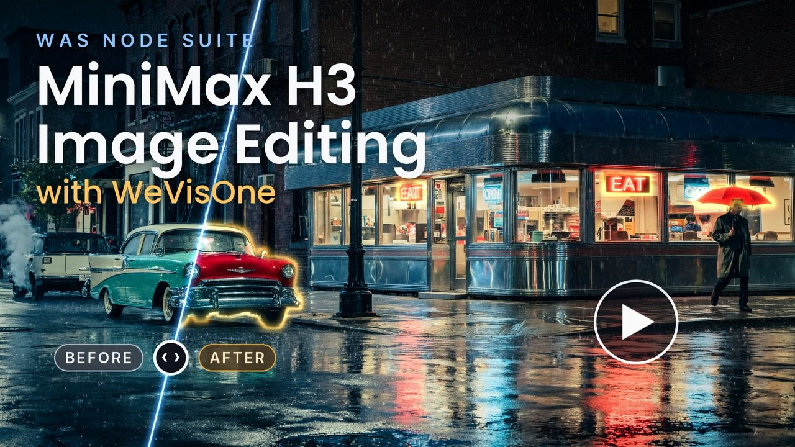
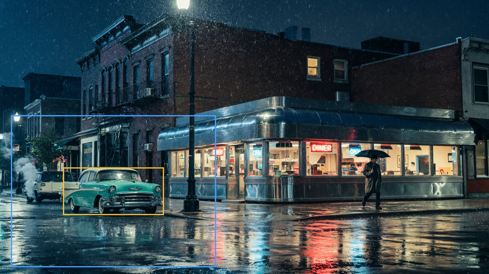
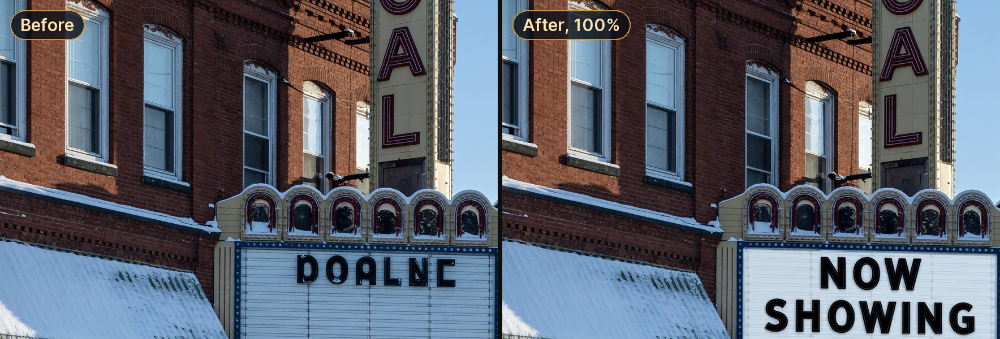
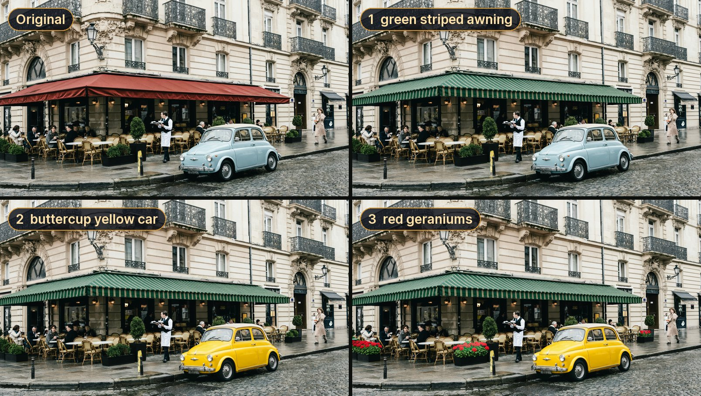

# Image editing

**Image Edit Crop** cuts the areas to change out of a picture at the size an edit model works at,
the edit model changes each crop, and **Image Edit Restore** pastes each change back through its
own area. Every pixel outside the areas stays as it was. The areas come from ComfyUI's
**WeVisOne-VL Detect**, named in a few words, or from things clicked on **Image Edit Regions**.
MiniMax H3 Image is the edit model in most of the graphs; any edit model that takes a picture and
a prompt sits between the two nodes.

[MiniMax H3 Image Editing with WeVisOne](https://youtu.be/Pv9H6EehsSY) shows the graphs below at
work and 62 edits on 30 pictures. Every input, output and tooltip is in [`NODES.md`](../NODES.md)
under **WAS Suite/Image/Edit**.

## The chain

| Stage | Node | Hands on |
|---|---|---|
| Find | **WeVisOne-VL Detect**, task `segmentation`, with a few words such as `the red car` | One mask per area found |
| | or **Image Edit Regions**, with things clicked on its panel | One job per edit, holding its mask and its prompt |
| Cut | **Image Edit Crop** | One crop per group of nearby areas, at the edit model's size, and a preview with each crop's window in blue and each area's box in amber |
| Edit | The edit model's own nodes | Each crop changed, at any size |
| Find again | A second **WeVisOne-VL Detect** on the edited crops, naming the result, such as `the mint green car` | What each crop holds where its area was |
| Paste | **Image Edit Restore** | The picture with every edit pasted through its own area and its colour drift removed, and a `changed` mask |

Image Edit Crop's outputs are lists, so every node between it and Image Edit Restore runs once per
crop. An area the second WeVisOne-VL Detect finds lying over an old one is pasted whole, one
beside it is left out, and one reaching the edge of its crop is pasted through the old area
alone. With the second detection unwired, or finding nothing, each edit is pasted through its old
area alone.

## Models

Each graph below carries the download link of every model it loads.

### MiniMax H3 Image, WeVisOne-VL and SAM 3.1

| File | Folder | Size | Loaded by | Licence |
|---|---|--:|---|---|
| [`minimax_h3_image_pruned_int8_convrot.safetensors`](https://huggingface.co/Comfy-Org/MiniMax-H3-Image/blob/main/diffusion_models/minimax_h3_image_pruned_int8_convrot.safetensors) | `ComfyUI/models/diffusion_models` | 21.0 GB | Load Diffusion Model | MiniMax H3 Image Community License Agreement |
| [`qwen3vl_32b_minimax_h3_int8_convrot.safetensors`](https://huggingface.co/Comfy-Org/MiniMax-H3-Image/blob/main/text_encoders/qwen3vl_32b_minimax_h3_int8_convrot.safetensors) | `ComfyUI/models/text_encoders` | 27.1 GB | Load CLIP, type `minimax` | MiniMax H3 Image Community License Agreement |
| [`minimax_h3_image_vae_fp16.safetensors`](https://huggingface.co/Comfy-Org/MiniMax-H3-Image/blob/main/vae/minimax_h3_image_vae_fp16.safetensors) | `ComfyUI/models/vae` | 1.2 GB | Load VAE | MiniMax H3 Image Community License Agreement |
| [`wevisone_vl_4b_bf16.safetensors`](https://huggingface.co/Comfy-Org/WeVisOne-VL/blob/main/text_encoders/wevisone_vl_4b_bf16.safetensors) | `ComfyUI/models/text_encoders` | 9.7 GB | Load CLIP, type `stable_diffusion`, for WeVisOne-VL Detect | Apache-2.0 |
| [`sam3.1_multiplex_fp16.safetensors`](https://huggingface.co/Comfy-Org/sam3.1/blob/main/checkpoints/sam3.1_multiplex_fp16.safetensors) | `ComfyUI/models/checkpoints` | 1.8 GB | Load Checkpoint, for Image Edit Regions | SAM License |

### Qwen-Image-Edit 2511

| File | Folder | Size | Loaded by | Licence |
|---|---|--:|---|---|
| [`qwen_image_edit_2511_fp8mixed.safetensors`](https://huggingface.co/Comfy-Org/Qwen-Image-Edit/blob/main/split_files/diffusion_models/qwen_image_edit_2511_fp8mixed.safetensors) | `ComfyUI/models/diffusion_models` | 20.5 GB | Load Diffusion Model | Apache-2.0 |
| [`Qwen-Image-Edit-2511-Lightning-4steps-V1.0-bf16.safetensors`](https://huggingface.co/lightx2v/Qwen-Image-Edit-2511-Lightning/blob/main/Qwen-Image-Edit-2511-Lightning-4steps-V1.0-bf16.safetensors) | `ComfyUI/models/loras` | 0.85 GB | Load LoRA | Apache-2.0 |
| [`qwen_2.5_vl_7b_fp8_scaled.safetensors`](https://huggingface.co/WAS/was-node-suite-weights/blob/main/models/kandinsky6/text_encoders/qwen_2.5_vl_7b_fp8_scaled.safetensors) | `ComfyUI/models/text_encoders` | 9.4 GB | Load CLIP, type `qwen_image` | Apache-2.0 |
| [`qwen_image_vae.safetensors`](https://huggingface.co/Comfy-Org/Krea-2/blob/main/vae/qwen_image_vae.safetensors) | `ComfyUI/models/vae` | 0.25 GB | Load VAE | Apache-2.0 |

### MOSS-Image

| File | Folder | Size | Loaded by | Licence |
|---|---|--:|---|---|
| [`moss_image_sft_int8_convrot.safetensors`](https://huggingface.co/Comfy-Org/MOSS-Image/blob/main/diffusion_models/moss_image_sft_int8_convrot.safetensors) | `ComfyUI/models/diffusion_models` | 5.4 GB | Load Diffusion Model | Apache-2.0 |
| [`moss_image_edit_lora_rank_64_bf16.safetensors`](https://huggingface.co/Comfy-Org/MOSS-Image/blob/main/loras/moss_image_edit_lora_rank_64_bf16.safetensors) | `ComfyUI/models/loras` | 0.30 GB | Load LoRA | Apache-2.0 |
| [`qwen3.5_9b_w4a8_gptq.safetensors`](https://huggingface.co/Comfy-Org/MOSS-Image/blob/main/text_encoders/qwen3.5_9b_w4a8_gptq.safetensors) | `ComfyUI/models/text_encoders` | 7.3 GB | Load CLIP, type `moss_image` | Apache-2.0 |
| [`flux2-vae_small.safetensors`](https://huggingface.co/Comfy-Org/MOSS-Image/blob/main/vae/flux2-vae_small.safetensors) | `ComfyUI/models/vae` | 0.25 GB | Load VAE | Apache-2.0 |

## Edit models

| Edit model | `max_resolution` | `min_resolution` | `multiple` | The prompt names the crop | Graph |
|---|--:|--:|--:|---|---|
| MiniMax H3 Image | 2048 | 1024 | 32 | `<Picture 1>` | [`minimax-h3-image-precise-edit.json`](workflows/minimax-h3-image-precise-edit.json) |
| Qwen-Image-Edit 2511 | 1536 | 1024 | 16 | `the picture` | [`qwen-image-edit-precise-edit.json`](workflows/qwen-image-edit-precise-edit.json) |
| MOSS-Image with its edit LoRA | 1536 | 1024 | 16 | the thing by name, such as `the striped awning` | [`moss-image-precise-edit.json`](workflows/moss-image-precise-edit.json) |

A crop larger than `max_resolution` is shrunk to it for the edit and enlarged back when it is
pasted. A smaller one is enlarged toward `min_resolution`, at most 4 times its size. Image Edit
Regions writes its prompts for the model on its `edit_model`: `MiniMax H3 Image` names the crop
`<Picture 1>`, `other` names it `the picture`.

Any other edit model takes the same wires:

| Wire | From | To |
|---|---|---|
| `crops` | Image Edit Crop | The edit model's picture input, and VAE Encode where the model samples from the crop's own latent |
| `prompts` | Image Edit Crop, with `jobs` wired from Image Edit Regions | The edit model's prompt |
| `crop_masks` | Image Edit Crop | The mask input of a model that inpaints |
| `edits` | Image Edit Crop | Image Edit Restore's `edits` |
| The edited picture | The edit model's VAE Decode | Image Edit Restore's `edited`, and the second WeVisOne-VL Detect's `image` |

In [`qwen-image-edit-precise-edit.json`](workflows/qwen-image-edit-precise-edit.json), Text
Encode Qwen Image Edit Plus reads the crop with no VAE wired, Set Reference Latent gives it the
crop's own latent, and KSampler samples 4 steps at cfg 1 with the Lightning LoRA.

In [`moss-image-precise-edit.json`](workflows/moss-image-precise-edit.json), the edit LoRA sits on
MOSS-Image SFT at strength 1 with Skip Layer Guidance on layer 22. Both Text Encode MOSS-Image
Edit nodes read the crop with the VAE wired and `edit_format` set to `Moss-Image-Edit`, and
KSampler samples 30 steps at cfg 4, euler, normal.

## MiniMax H3 Image prompts

| Part | Example |
|---|---|
| The change, and the shape it keeps | `Repaint the car in <Picture 1> deep cherry red and cream, keeping its exact shape, chrome trim and whitewall tires.` |
| Lettering, in double quotes | `Change the letters on the theater marquee in <Picture 1> to read "NOW SHOWING" in clean black letters, same sign and size.` |
| The close of every edit | `Keep everything else in <Picture 1> exactly the same.` |

## Edits in a loop

[`wevisone-incremental-editing-loop.json`](workflows/wevisone-incremental-editing-loop.json)
makes every edit in one stage inside a **For Loop**. Three **Multiline Text Lists** hold one line
per edit, paired by position, and each pass edits the picture the pass before it made.

| List | Line 1 |
|---|---|
| What to find | `the red car` |
| The change | `Repaint the car in <Picture 1> a pale mint green with cream accents, keeping its exact shape and chrome trim. Keep everything else in <Picture 1> exactly the same.` |
| What to find once it is made | `the mint green car` |

A line added to each list adds an edit. Lists of different lengths stop the run with a message
naming the list that ran out.

## Image Edit Regions

SAM 3.1 finds the things in the picture when the node runs. With no edits picked, the run stops
after the finding, and the things found are drawn on the panel to pick from.

| On the picture | Does |
|---|---|
| Click a thing | Starts an edit on the smallest thing found there, or selects the edit already holding it |
| Click the same spot again | Moves the edit to the next larger thing found there |
| Shift-click | Adds a thing to the selected edit or takes it out; on an empty spot, adds a point |
| Right-click | Takes the thing under the pointer out of its edit |
| Wheel, and drag | Zooms, and pans while zoomed in |
| Double-click | Resets the zoom |
| Delete or Backspace | Removes the selected edit |
| Escape | Deselects |

| Action on the card | Prompt written |
|---|---|
| Edit | `Change the <thing> in <Picture 1> to `, finished by hand |
| Recolour, to | `Recolour the <thing> in <Picture 1> to <colour>, keeping its shape, material and folds.` |
| Replace, with | `Replace the <thing> in <Picture 1> with <thing>, in the same place and at the same size.` |
| Remove | `Remove the <thing> from <Picture 1> and fill in what was behind it so it matches its surroundings.` |

A prompt typed on the card replaces the written one. **Include its shadow** adds the shadows found
touching the thing to its edit. **Paste its box** pastes the edit through its whole box rather
than its outline, and starts on for Replace and Remove.

## Graphs

Every graph reads [`wevisone-busy-street.jpg`](workflows/wevisone-busy-street.jpg) from
`ComfyUI/input`.

| Graph | Makes |
|---|---|
| [`minimax-h3-image-precise-edit.json`](workflows/minimax-h3-image-precise-edit.json) | One edit with MiniMax H3 Image: a raincoat turned into a navy wool coat |
| [`qwen-image-edit-precise-edit.json`](workflows/qwen-image-edit-precise-edit.json) | One edit with Qwen-Image-Edit 2511: the striped awning turned plain green |
| [`moss-image-precise-edit.json`](workflows/moss-image-precise-edit.json) | One edit with MOSS-Image and its edit LoRA: the striped awning turned deep forest green |
| [`wevisone-incremental-editing.json`](workflows/wevisone-incremental-editing.json) | Six edits with MiniMax H3 Image, one stage each |
| [`wevisone-incremental-editing-loop.json`](workflows/wevisone-incremental-editing-loop.json) | The same six edits from three lists, in a For Loop |
| [`image-edit-regions.json`](workflows/image-edit-regions.json) | Edits picked on Image Edit Regions' panel, made with MiniMax H3 Image |

## Troubleshooting

| What happens | Cause | Fix |
|---|---|---|
| An overcast picture comes back sunlit where it was edited | The prompt asks MiniMax H3 Image to keep the lighting or the shadows, and it paints them as direct sun | Leave light, lighting, shadow and sunlight out of the prompt |
| Part of a thing keeps its old colour | WeVisOne-VL Detect's mask missed that part | Add an edit naming the part, such as `the pink rear fender of the car` |
| A replacement ends in a straight edge, or only fills the old thing's outline | The second WeVisOne-VL Detect names the old thing, or finds the new one reaching the edge of its crop, so the edit is pasted through the old area alone | Name the result in the second WeVisOne-VL Detect, such as `the cat`, and raise `context` until the crop holds all of it |
| A Qwen-Image-Edit edit lands shifted | Text Encode Qwen Image Edit Plus has its `vae` wired, and resizes its reference picture to about one megapixel | Leave its `vae` unwired and give it the crop's latent through Set Reference Latent |
| A MOSS-Image edit redraws the crop, or drifts in identity and framing | The two Text Encode MOSS-Image Edit nodes carry an `edit_format` the LoRA was not trained with, or the LoRA's strength is below 1 | Set `edit_format` to `Moss-Image-Edit` on both, and the LoRA's strength to 1 |
| A large area comes back soft | Its crop was shrunk to `max_resolution` and enlarged back when pasted | Raise `max_resolution` to the largest size the edit model takes |
