# Workflow index

All 133 example graphs in [`docs/workflows`](workflows), by area. A file opens when it is dragged onto the ComfyUI canvas, or from the Workflows sidebar once it is in `ComfyUI/user/default/workflows`, and ComfyUI offers each model it lacks for download.

| Section | Workflows |
|---|--:|
| [Image generation and sampling](#image-generation-and-sampling) | 17 |
| [Image editing](#image-editing) | 10 |
| [Photo and film looks](#photo-and-film-looks) | 4 |
| [Colour, HDR and scopes](#colour-hdr-and-scopes) | 5 |
| [Masks, regions and subjects](#masks-regions-and-subjects) | 7 |
| [Filters, layers and preprocessors](#filters-layers-and-preprocessors) | 10 |
| [MiniMax H3 video](#minimax-h3-video) | 20 |
| [Kandinsky 6 video](#kandinsky-6-video) | 2 |
| [Video editing and restoration](#video-editing-and-restoration) | 8 |
| [3D and Three.js](#3d-and-threejs) | 15 |
| [Prompts and text](#prompts-and-text) | 9 |
| [Language models and Llama-Index](#language-models-and-llama-index) | 11 |
| [Files, datasets and documents](#files-datasets-and-documents) | 7 |
| [Logic, loops and apps](#logic-loops-and-apps) | 8 |

---

## Image generation and sampling

| Preview | Workflow | What it does | Get it |
|---|---|---|---|
|  | **MiniMax H3 Image at 16 megapixels** | Text to image with MiniMax H3 Image through H3 Image Sampler, at 16 megapixels on a 24 GB card with H3 Low VRAM and Free Memory. | [open](workflows/minimax-h3-image-sampler.json) [download](https://raw.githubusercontent.com/WASasquatch/was-node-suite-comfyui/main/docs/workflows/minimax-h3-image-sampler.json) |
| <a href="workflows/images/h3-image-blank-guidance.webp">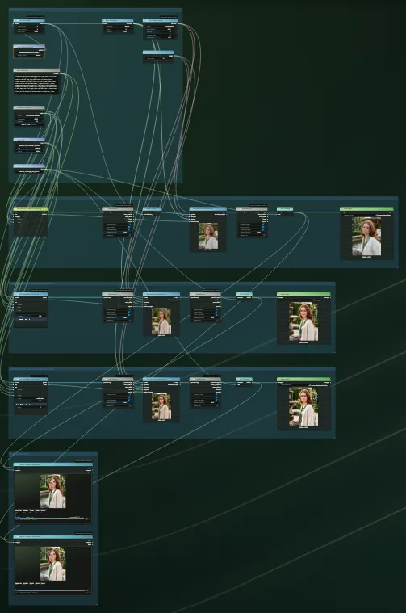</a> | **MiniMax H3 Image with blank guidance** | One prompt at 16 MP three ways: plain, H3 Image Blank Guidance in blank mode for clean, photographic skin, and in subtraction mode for more detail, each compared with plain. | [open](workflows/h3-image-blank-guidance.json) [download](https://raw.githubusercontent.com/WASasquatch/was-node-suite-comfyui/main/docs/workflows/h3-image-blank-guidance.json) |
|  | **MiniMax H3 Image with VisRow conditioning** | One prompt at 16 MP with MiniMax H3 Image Conditioning and with H3 Image VisRow Conditioning at strength 1, compared, then the VisRow picture edited as Picture 1 through a second VisRow node. | [open](workflows/h3-image-visrow.json) [download](https://raw.githubusercontent.com/WASasquatch/was-node-suite-comfyui/main/docs/workflows/h3-image-visrow.json) |
|  | **MiniMax H3 Image with a prompt enhancer** | MiniMax H3 Image text to image with a switchable prompt enhancer that expands a few words into a full caption and picks the aspect ratio, starting at 4 megapixels. | [open](workflows/image_minimax_h3_image_t2i.json) [download](https://raw.githubusercontent.com/WASasquatch/was-node-suite-comfyui/main/docs/workflows/image_minimax_h3_image_t2i.json) |
|  | **Fibo 2.0 generate and edit** | Generate Fibo 2 Prompt writes a structured caption, Fibo 2.0 Dev renders it, and Fibo 2.0 Edit Turbo changes a loaded picture from an instruction. | [open](workflows/fibo2-generate-edit.json) [download](https://raw.githubusercontent.com/WASasquatch/was-node-suite-comfyui/main/docs/workflows/fibo2-generate-edit.json) |
|  | **BluePixel text to image** | BluePixel-Turbo renders a picture from a prompt with its own loaders and scheduler. | [open](workflows/bluepixel-text-to-image.json) [download](https://raw.githubusercontent.com/WASasquatch/was-node-suite-comfyui/main/docs/workflows/bluepixel-text-to-image.json) |
|  | **Generate, judge and retry** | Z-Image Turbo renders a prompt, a language model scores the result with Judge Images, and Revise Prompt rewrites the prompt from its notes until a picture passes or the tries run out. | [open](workflows/generate-refine-loop.json) [download](https://raw.githubusercontent.com/WASasquatch/was-node-suite-comfyui/main/docs/workflows/generate-refine-loop.json) |
|  | **Affine texture on Krea 2** | Krea 2 Turbo text to image with Custom Sampler Affine Advanced pushing texture into the latent as it forms, beside the plain render, with an optional language model prompt rewrite. | [open](workflows/affine-krea2.json) [download](https://raw.githubusercontent.com/WASasquatch/was-node-suite-comfyui/main/docs/workflows/affine-krea2.json) |
|  | **Colored noise sampling on FLUX.2 klein 9B** | Three FLUX.2 klein 9B renders of one seed, euler_ancestral with and without CNS Model Patch and plain euler, compared side by side. | [open](workflows/cns-klein9b.json) [download](https://raw.githubusercontent.com/WASasquatch/was-node-suite-comfyui/main/docs/workflows/cns-klein9b.json) |
|  | **Colored noise sampling on Krea 2** | Three Krea 2 renders of one seed, euler_ancestral with and without CNS Model Patch and plain euler, compared side by side. | [open](workflows/cns-krea2.json) [download](https://raw.githubusercontent.com/WASasquatch/was-node-suite-comfyui/main/docs/workflows/cns-krea2.json) |
|  | **FLUX 3 Klein distilled on its base model** | The FLUX 3 Image Klein base model with a distillation LoRA and Flux 3 Flow Map Patch, sampled in 16 steps at CFG 1 and at CFG 2.5, compared. | [open](workflows/flux3-klein-distill-lora.json) [download](https://raw.githubusercontent.com/WASasquatch/was-node-suite-comfyui/main/docs/workflows/flux3-klein-distill-lora.json) |
|  | **FLUX 3 Klein in tiles** | A FLUX 3 Image Klein frame larger than its native size, laid out whole and finished in tiles by Tiled Diffusion Model Patch, with Flow Shift and Shifted Tangent Scheduler, beside a plain render. | [open](workflows/flux3-klein-tiled-diffusion.json) [download](https://raw.githubusercontent.com/WASasquatch/was-node-suite-comfyui/main/docs/workflows/flux3-klein-tiled-diffusion.json) |
|  | **MOSS-Image at high resolution** | MOSS-Image past its native size with Model Block Restore against banding, RoPE Extension Patch and Tiled Diffusion Model Patch, compared with a plain render. | [open](workflows/moss-image-high-res.json) [download](https://raw.githubusercontent.com/WASasquatch/was-node-suite-comfyui/main/docs/workflows/moss-image-high-res.json) |
|  | **Spectrum Forecast and Adaptive Detail** | One prompt sampled four ways: plain, with Spectrum Forecast, with Adaptive Detail, and with both, each pair compared. | [open](workflows/spectrum-and-adaptive-detail.json) [download](https://raw.githubusercontent.com/WASasquatch/was-node-suite-comfyui/main/docs/workflows/spectrum-and-adaptive-detail.json) |
|  | **Fast KSampler and fast savers** | An SDXL batch through Fast KSampler, saved by Image Save, quantized to 24 colours and written as an animated WebP by Fast Save Animated WEBP. | [open](workflows/fast-samplers-and-savers.json) [download](https://raw.githubusercontent.com/WASasquatch/was-node-suite-comfyui/main/docs/workflows/fast-samplers-and-savers.json) |
|  | **LoRA strength per step** | Number Sequence holds a LoRA back until the layout is set and Power LoRA Loader applies it step by step, beside the same LoRA at full strength from step 1. | [open](workflows/number-sequence-lora-schedule.json) [download](https://raw.githubusercontent.com/WASasquatch/was-node-suite-comfyui/main/docs/workflows/number-sequence-lora-schedule.json) |
|  | **Power LoRA stack and merge** | Power LoRA Loader stacks two slider LoRAs, and Power LoRA Merger writes them into one new LoRA file, once from the stack and once from the model link. | [open](workflows/power-lora-stack.json) [download](https://raw.githubusercontent.com/WASasquatch/was-node-suite-comfyui/main/docs/workflows/power-lora-stack.json) |

---

## Image editing

| Preview | Workflow | What it does | Get it |
|---|---|---|---|
|  | **Edits picked on the picture** | Image Edit Regions finds things in a picture with SAM 3.1; each one clicked on the node is edited by MiniMax H3 Image through Image Edit Crop and pasted back by Image Edit Restore. | [open](workflows/image-edit-regions.json) [download](https://raw.githubusercontent.com/WASasquatch/was-node-suite-comfyui/main/docs/workflows/image-edit-regions.json) |
|  | **Precise edit with MiniMax H3 Image** | WeVisOne-VL Detect finds a raincoat, Image Edit Crop cuts it out, MiniMax H3 Image turns it into a navy wool coat, and Image Edit Restore pastes it back with the rest untouched. | [open](workflows/minimax-h3-image-precise-edit.json) [download](https://raw.githubusercontent.com/WASasquatch/was-node-suite-comfyui/main/docs/workflows/minimax-h3-image-precise-edit.json) |
|  | **Precise edit with Qwen-Image-Edit 2511** | The same crop and restore chain with Qwen-Image-Edit 2511: a striped awning found, cut out at 1536 pixels, turned plain green and pasted back. | [open](workflows/qwen-image-edit-precise-edit.json) [download](https://raw.githubusercontent.com/WASasquatch/was-node-suite-comfyui/main/docs/workflows/qwen-image-edit-precise-edit.json) |
|  | **Precise edit with MOSS-Image** | The same crop and restore chain with MOSS-Image SFT and its edit LoRA: a striped awning found, cut out at 1536 pixels, turned deep green and pasted back. | [open](workflows/moss-image-precise-edit.json) [download](https://raw.githubusercontent.com/WASasquatch/was-node-suite-comfyui/main/docs/workflows/moss-image-precise-edit.json) |
|  | **Six edits, one stage each** | Six edits to one street photograph with MiniMax H3 Image, each found by WeVisOne-VL Detect and made at the edit model's resolution: a car, an awning, coffee cups, a dog, a cap and an outfit. | [open](workflows/wevisone-incremental-editing.json) [download](https://raw.githubusercontent.com/WASasquatch/was-node-suite-comfyui/main/docs/workflows/wevisone-incremental-editing.json) |
|  | **Six edits in a For Loop** | The same six edits made by one stage inside a For Loop, read from three Multiline Text Lists; another edit is one more line in each list. | [open](workflows/wevisone-incremental-editing-loop.json) [download](https://raw.githubusercontent.com/WASasquatch/was-node-suite-comfyui/main/docs/workflows/wevisone-incremental-editing-loop.json) |
|  | **BluePixel 4K edit** | BluePixel-Turbo edits a picture at its full size from one English instruction in four steps, compared with the original. | [open](workflows/bluepixel-edit.json) [download](https://raw.githubusercontent.com/WASasquatch/was-node-suite-comfyui/main/docs/workflows/bluepixel-edit.json) |
|  | **BluePixel edit, judge and retry** | Generate Edit Instruction expands a short request, BluePixel-Turbo makes the edit, and Judge Images scores it, rewriting the instruction from its notes until an edit passes. | [open](workflows/bluepixel-refine-loop.json) [download](https://raw.githubusercontent.com/WASasquatch/was-node-suite-comfyui/main/docs/workflows/bluepixel-refine-loop.json) |
|  | **FLUX.2 klein edit, judge and retry** | The edit, judge and retry loop on FLUX.2 klein 9B with reference latents, ending on the best scored edit. | [open](workflows/edit-refine-loop.json) [download](https://raw.githubusercontent.com/WASasquatch/was-node-suite-comfyui/main/docs/workflows/edit-refine-loop.json) |
| <a href="workflows/images/portrait-retouch.webp">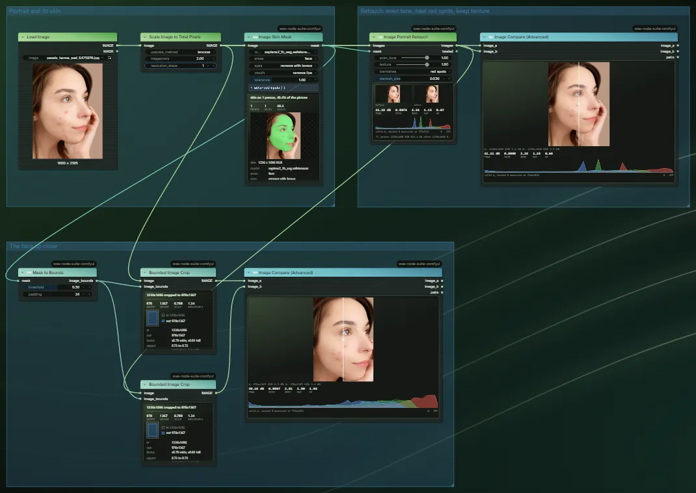</a> | **Portrait retouch** | Image Skin Mask finds the face, and Image Portrait Retouch evens blotchy redness and heals small red spots while keeping pores and lines, compared whole and up close. | [open](workflows/portrait-retouch.json) [download](https://raw.githubusercontent.com/WASasquatch/was-node-suite-comfyui/main/docs/workflows/portrait-retouch.json) |

---

## Photo and film looks

| Preview | Workflow | What it does | Get it |
|---|---|---|---|
| <a href="workflows/images/photo-develop.webp">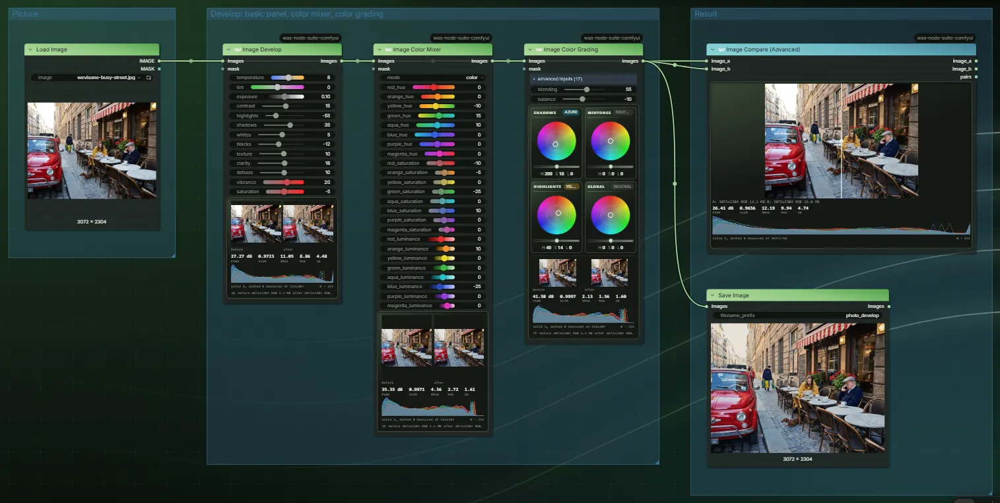</a> | **Photo develop** | A photograph through Image Develop, Image Color Mixer and Image Color Grade, the basic panel, mixer and grading wheels of a raw developer, compared with the original. | [open](workflows/photo-develop.json) [download](https://raw.githubusercontent.com/WASasquatch/was-node-suite-comfyui/main/docs/workflows/photo-develop.json) |
| <a href="workflows/images/photo-looks.webp">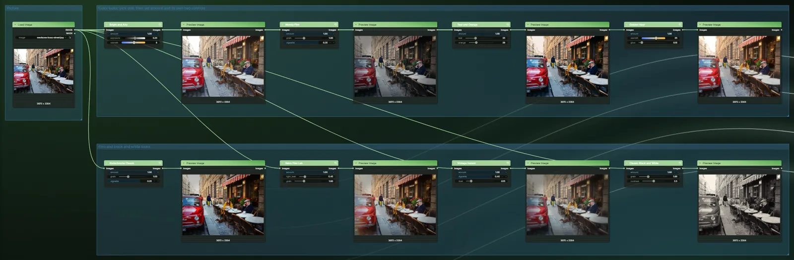</a> | **Photo and film looks** | Eight of the look subgraphs on one picture, from Bright and Airy to Classic Black and White, each with an amount and two controls of its own. | [open](workflows/photo-looks.json) [download](https://raw.githubusercontent.com/WASasquatch/was-node-suite-comfyui/main/docs/workflows/photo-looks.json) |
| <a href="workflows/images/film-lab.webp">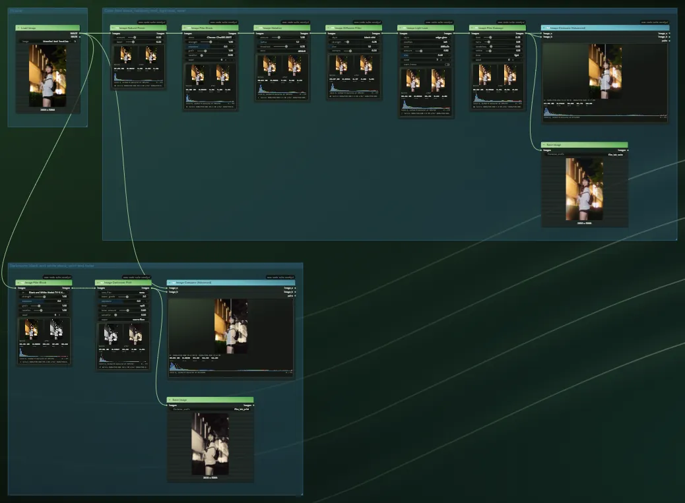</a> | **Film lab** | A colour film chain of stock, halation, diffusion mist, light leak and wear, and a darkroom chain of black and white stock, print and toner, each compared with the picture. | [open](workflows/film-lab.json) [download](https://raw.githubusercontent.com/WASasquatch/was-node-suite-comfyui/main/docs/workflows/film-lab.json) |
|  | **Image Style Filter presets** | Six Image Style Filter presets on one picture: Earlybird, Rise, 1977, Kelvin, Walden and Lark. | [open](workflows/image-style-filter.json) [download](https://raw.githubusercontent.com/WASasquatch/was-node-suite-comfyui/main/docs/workflows/image-style-filter.json) |

---

## Colour, HDR and scopes

| Preview | Workflow | What it does | Get it |
|---|---|---|---|
| <a href="workflows/images/bake-look-to-lut.webp">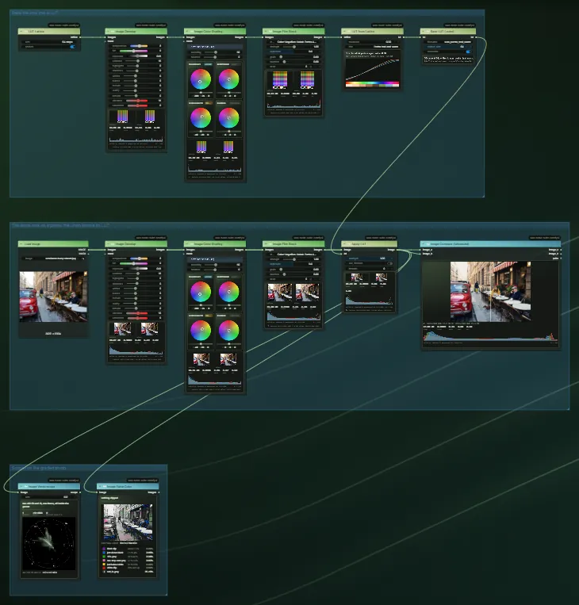</a> | **Bake a look into a LUT** | A develop, grade and film stock chain baked into a .cube LUT through LUT Lattice, applied to a photo beside the chain it came from, with false colour and a vectorscope on the result. | [open](workflows/bake-look-to-lut.json) [download](https://raw.githubusercontent.com/WASasquatch/was-node-suite-comfyui/main/docs/workflows/bake-look-to-lut.json) |
|  | **Scopes before and after a grade** | A LUT grade checked with channel waveforms, image statistics and a before and after comparison. | [open](workflows/analysis-readouts.json) [download](https://raw.githubusercontent.com/WASasquatch/was-node-suite-comfyui/main/docs/workflows/analysis-readouts.json) |
|  | **HDR decode, dequantise and reconstruct** | HDR VAE Decode beside VAE Decode through the same filters, then a banded, clipped 8-bit frame repaired by Image Dequantise and HDR Reconstruct and written as EXR and DNG. | [open](workflows/hdr.json) [download](https://raw.githubusercontent.com/WASasquatch/was-node-suite-comfyui/main/docs/workflows/hdr.json) |
|  | **Optics and grade** | Lens distortion, perspective, directional blur, vignette, auto levels, colour balance, tone mapping and a matte, each previewed on one picture. | [open](workflows/image-optics-and-grade.json) [download](https://raw.githubusercontent.com/WASasquatch/was-node-suite-comfyui/main/docs/workflows/image-optics-and-grade.json) |
| <a href="workflows/images/color-management.webp">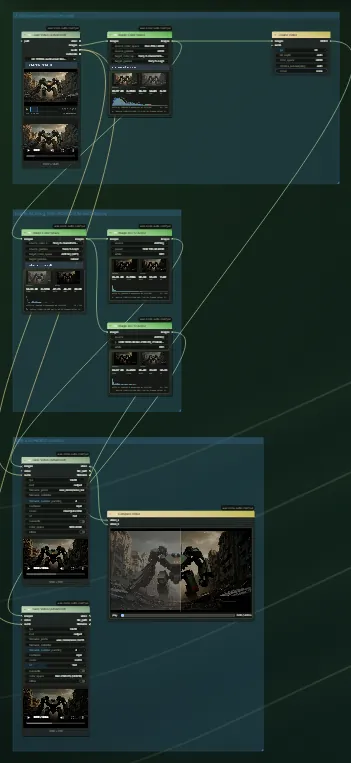</a> | **Camera log to SDR and HDR10** | A clip in Sony S-Log3 decoded into ACEScg by Image Color Space, rendered by Image ACES Output for an sRGB screen and for 1000 nit HDR10, and saved as tagged SDR and 10-bit HDR video. | [open](workflows/color-management.json) [download](https://raw.githubusercontent.com/WASasquatch/was-node-suite-comfyui/main/docs/workflows/color-management.json) |

---

## Masks, regions and subjects

| Preview | Workflow | What it does | Get it |
|---|---|---|---|
| <a href="workflows/images/local-adjustments.webp">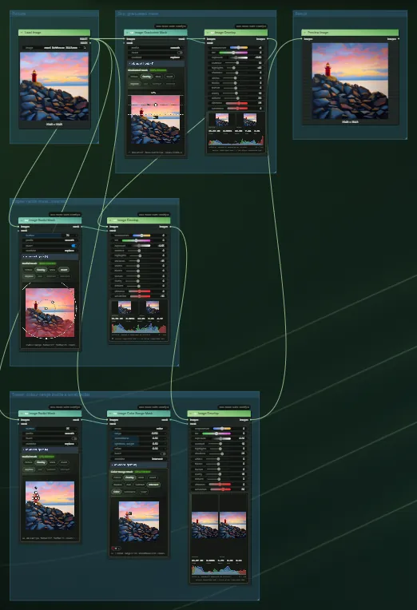</a> | **Local adjustments** | Image Develop applied through a graduated mask on the sky, an inverted radial mask on the edges and a colour range mask on a tower. | [open](workflows/local-adjustments.json) [download](https://raw.githubusercontent.com/WASasquatch/was-node-suite-comfyui/main/docs/workflows/local-adjustments.json) |
| <a href="workflows/images/subject-spotlight.webp">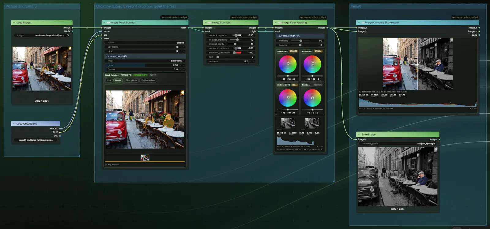</a> | **Subject spotlight** | A subject clicked on Image Track Subject with SAM 3 is kept in colour and lit by Image Spotlight while the rest is graded down. | [open](workflows/subject-spotlight.json) [download](https://raw.githubusercontent.com/WASasquatch/was-node-suite-comfyui/main/docs/workflows/subject-spotlight.json) |
|  | **Skin masks** | Image Skin Mask and Image Simple Skin Mask on the same portrait, compared. | [open](workflows/image-skin-mask.json) [download](https://raw.githubusercontent.com/WASasquatch/was-node-suite-comfyui/main/docs/workflows/image-skin-mask.json) |
|  | **Mask bounds** | A subject's mask measured as bounds, drawn on the picture, read out as numbers and filled back as a mask at the picture's size. | [open](workflows/mask-bounds.json) [download](https://raw.githubusercontent.com/WASasquatch/was-node-suite-comfyui/main/docs/workflows/mask-bounds.json) |
|  | **Rectangle masks** | Four Mask Rect Area (Advanced) settings, each previewed. | [open](workflows/mask-rect-area.json) [download](https://raw.githubusercontent.com/WASasquatch/was-node-suite-comfyui/main/docs/workflows/mask-rect-area.json) |
|  | **Face crop and paste** | A face cropped by Image Crop Face, pixelated, and pasted back by Image Paste Face. | [open](workflows/face-detection.json) [download](https://raw.githubusercontent.com/WASasquatch/was-node-suite-comfyui/main/docs/workflows/face-detection.json) |
|  | **Bounding boxes with ComfyUI's own nodes** | Bounding boxes filtered and turned into bounds, a drawn outline and a mask, and into layers through ComfyUI's Layers From Bounding Boxes, with an Image Analyze histogram on ComfyUI's Curve Editor. | [open](workflows/comfyui-interop.json) [download](https://raw.githubusercontent.com/WASasquatch/was-node-suite-comfyui/main/docs/workflows/comfyui-interop.json) |

---

## Filters, layers and preprocessors

| Preview | Workflow | What it does | Get it |
|---|---|---|---|
| <a href="workflows/images/lens-blur.webp">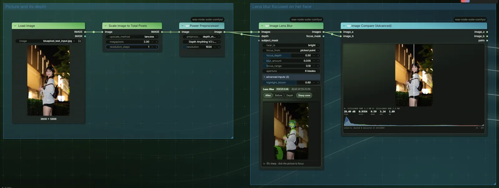</a> | **Lens blur from depth** | A Depth Anything V2 depth map from Power Preprocessor drives Image Lens Blur, focused on a point picked on her face with six-blade bokeh, compared with the original. | [open](workflows/lens-blur.json) [download](https://raw.githubusercontent.com/WASasquatch/was-node-suite-comfyui/main/docs/workflows/lens-blur.json) |
|  | **Morphology and resize** | Image Morphology beside ComfyUI's Morphology on the same top hat setting, and Image Resize beside ComfyUI's Image Scale. | [open](workflows/image-morphology-and-resize.json) [download](https://raw.githubusercontent.com/WASasquatch/was-node-suite-comfyui/main/docs/workflows/image-morphology-and-resize.json) |
|  | **Scale to total pixels** | A 3840 x 2160 photo capped at 1 megapixel, and a 768 x 768 picture under the cap passed through untouched. | [open](workflows/scale-to-total-pixels.json) [download](https://raw.githubusercontent.com/WASasquatch/was-node-suite-comfyui/main/docs/workflows/scale-to-total-pixels.json) |
|  | **Arabic and Hebrew captions** | Image Draw Text writing Arabic and Hebrew captions in DejaVu Sans, and an Arabic caption in Liberation Sans. | [open](workflows/image-draw-text.json) [download](https://raw.githubusercontent.com/WASasquatch/was-node-suite-comfyui/main/docs/workflows/image-draw-text.json) |
|  | **A layer stack** | Pictures built into a layer stack, then aligned, fitted, masked, given strokes, glows and shadows, arranged, merged and flattened, beside ComfyUI's Image Compositor. | [open](workflows/layers.json) [download](https://raw.githubusercontent.com/WASasquatch/was-node-suite-comfyui/main/docs/workflows/layers.json) |
|  | **Layered PSD round trip** | Three pictures saved as a 16-bit layered PSD by Layers Save and read back by Layers Load, with the stack's details printed. | [open](workflows/layers-psd.json) [download](https://raw.githubusercontent.com/WASasquatch/was-node-suite-comfyui/main/docs/workflows/layers-psd.json) |
|  | **Ambient occlusion from a depth map** | Image SSAO shading a picture from a Power Preprocessor depth map, compared with the original. | [open](workflows/ssao-height-map.json) [download](https://raw.githubusercontent.com/WASasquatch/was-node-suite-comfyui/main/docs/workflows/ssao-height-map.json) |
|  | **Every Power Preprocessor mode** | Power Preprocessor in every mode and model it accepts: depth, normals, pose, segments, edges and lines, intrinsics and restoration, with sweeps of its controls, a batch and two resolutions. | [open](workflows/preprocessors.json) [download](https://raw.githubusercontent.com/WASasquatch/was-node-suite-comfyui/main/docs/workflows/preprocessors.json) |
|  | **Marigold v2 depth, normals and albedo** | Power Preprocessor's Marigold v2 mode reading depth, surface normals and albedo from one picture. | [open](workflows/marigold-v2.json) [download](https://raw.githubusercontent.com/WASasquatch/was-node-suite-comfyui/main/docs/workflows/marigold-v2.json) |
|  | **Marigold v2 at two sizes** | Marigold v2 normals and albedo at 768 and depth at 1280, with the model and VAEs loaded on their own loaders. | [open](workflows/marigold-v2-preprocessor.json) [download](https://raw.githubusercontent.com/WASasquatch/was-node-suite-comfyui/main/docs/workflows/marigold-v2-preprocessor.json) |

---

## MiniMax H3 video

| Preview | Workflow | What it does | Get it |
|---|---|---|---|
|  | **Prompt Timeline video** | A three scene MiniMax H3 video laid out on the Prompt Timeline, each scene sampled by fl2va or ref2va in a While Loop and joined with carried sound and a referenced cut. | [open](workflows/minimax-h3-prompt-timeline.json) [download](https://raw.githubusercontent.com/WASasquatch/was-node-suite-comfyui/main/docs/workflows/minimax-h3-prompt-timeline.json) |
|  | **H3 extend loop** | A long MiniMax H3 text to video built segment by segment in a While Loop, each carrying the shot on from the last, with a report per segment. | [open](workflows/minimax-h3-extend-loop.json) [download](https://raw.githubusercontent.com/WASasquatch/was-node-suite-comfyui/main/docs/workflows/minimax-h3-extend-loop.json) |
|  | **H3 scene loop** | An animated short in MiniMax H3, its scenes joined by cuts and carries in one While Loop and decoded scene by scene by H3 Decode Video. | [open](workflows/minimax-h3-scene-loop.json) [download](https://raw.githubusercontent.com/WASasquatch/was-node-suite-comfyui/main/docs/workflows/minimax-h3-scene-loop.json) |
|  | **H3 extend loop with sound across cuts** | The animated short with its soundtrack carried across picture cuts, so the sound runs on while the shot changes. | [open](workflows/minimax-h3-extend-loop-audio-carry.json) [download](https://raw.githubusercontent.com/WASasquatch/was-node-suite-comfyui/main/docs/workflows/minimax-h3-extend-loop-audio-carry.json) |
|  | **H3 extend loop on references** | A MiniMax H3 ref2va video whose segments share reference pictures, a clip and a sound, named in the prompts as Picture, Video and Audio tags. | [open](workflows/minimax-h3-ref2va-extend-loop.json) [download](https://raw.githubusercontent.com/WASasquatch/was-node-suite-comfyui/main/docs/workflows/minimax-h3-ref2va-extend-loop.json) |
|  | **H3 cast saved as RefMods** | The reference video with its cast encoded once by MiniMax H3 Save RefMod and loaded back by MiniMax H3 RefMod, so no reference is encoded again on later runs. | [open](workflows/minimax-h3-refmods.json) [download](https://raw.githubusercontent.com/WASasquatch/was-node-suite-comfyui/main/docs/workflows/minimax-h3-refmods.json) |
|  | **H3 keyframe pairs** | A folder of keyframes read as pairs, each pair a segment that opens on one frame and closes on the next, sampled in a While Loop and joined. | [open](workflows/minimax-h3-flf-pair-loop.json) [download](https://raw.githubusercontent.com/WASasquatch/was-node-suite-comfyui/main/docs/workflows/minimax-h3-flf-pair-loop.json) |
|  | **H3 extend loop with De-RoPE** | A Prompt Timeline video whose every segment is stretched, refined and recovered by the De-RoPE nodes before it joins, so fast motion is re-rendered at a slowed pace. | [open](workflows/minimax-h3-extend-loop-derope.json) [download](https://raw.githubusercontent.com/WASasquatch/was-node-suite-comfyui/main/docs/workflows/minimax-h3-extend-loop-derope.json) |
|  | **De-RoPE a finished clip** | A finished MiniMax H3 clip stretched where it moves fastest by H3 De-RoPE Stretch, refined, and put back on its own timing by H3 De-RoPE Recover, compared with the source. | [open](workflows/minimax-h3-derope.json) [download](https://raw.githubusercontent.com/WASasquatch/was-node-suite-comfyui/main/docs/workflows/minimax-h3-derope.json) |
|  | **De-RoPE a text to video clip** | A MiniMax H3 clip generated from text, then stretched, refined and recovered by the De-RoPE nodes, compared with the plain render. | [open](workflows/minimax-h3-derope-t2v.json) [download](https://raw.githubusercontent.com/WASasquatch/was-node-suite-comfyui/main/docs/workflows/minimax-h3-derope-t2v.json) |
|  | **H3 sparse attention** | One MiniMax H3 image to video clip sampled with dense attention and with H3 Sparse Attention, compared side by side. | [open](workflows/minimax-h3-sparse-attention.json) [download](https://raw.githubusercontent.com/WASasquatch/was-node-suite-comfyui/main/docs/workflows/minimax-h3-sparse-attention.json) |
|  | **H3 scene attention** | A three-shot MiniMax H3 clip sampled with full attention and with H3 Scene Attention, each shot reading its own text, compared side by side. | [open](workflows/minimax-h3-scene-attention.json) [download](https://raw.githubusercontent.com/WASasquatch/was-node-suite-comfyui/main/docs/workflows/minimax-h3-scene-attention.json) |
|  | **H3 World actions** | A first frame driven like a game with H3 World: walking forward, then strafing left, with a pan to the right, set on H3 World Actions' timeline. | [open](workflows/minimax-h3-world.json) [download](https://raw.githubusercontent.com/WASasquatch/was-node-suite-comfyui/main/docs/workflows/minimax-h3-world.json) |
|  | **Structure video rendered with H3** | A grey-box square turning around a standing figure, rendered in Three, then turned into finished MiniMax H3 footage in four steps with H3 Structure Video and H3 Structure Renderer. | [open](workflows/minimax-h3-solar-renderer.json) [download](https://raw.githubusercontent.com/WASasquatch/was-node-suite-comfyui/main/docs/workflows/minimax-h3-solar-renderer.json) |
|  | **H3 in four steps with PTD** | H3 PTD Patch on an fl2va model for text to video with sound, and on a ref2va model from one reference picture, each in four steps. | [open](workflows/minimax-h3-ptd.json) [download](https://raw.githubusercontent.com/WASasquatch/was-node-suite-comfyui/main/docs/workflows/minimax-h3-ptd.json) |
|  | **Pika H3 Flex in two passes** | Pika H3 Flex image to video at 480p in six steps, then refined at 768p from a later knot through H3 Hires Latent. | [open](workflows/minimax-h3-pika-flex.json) [download](https://raw.githubusercontent.com/WASasquatch/was-node-suite-comfyui/main/docs/workflows/minimax-h3-pika-flex.json) |
|  | **PikaTD in four steps** | PikaTD files through H3 PTD Patch: a first frame to video, a clip from one reference picture, and text to video with speech, each in four steps with sound. | [open](workflows/minimax-h3-pikatd.json) [download](https://raw.githubusercontent.com/WASasquatch/was-node-suite-comfyui/main/docs/workflows/minimax-h3-pikatd.json) |
|  | **Affine texture on H3 image to video** | MiniMax H3 image to video with Custom Sampler Affine Advanced and Temporal Noise Hold, with a switch for a Lightning LoRA and its step count. | [open](workflows/affine-minimax-h3-example.json) [download](https://raw.githubusercontent.com/WASasquatch/was-node-suite-comfyui/main/docs/workflows/affine-minimax-h3-example.json) |
|  | **Affine texture on an H3 extend loop** | A hand-drawn anime MiniMax H3 video built in a While Loop, every segment sampled by Custom Sampler Affine Advanced, joined by cuts and carries. | [open](workflows/affine-minimax-h3-extend-loop.json) [download](https://raw.githubusercontent.com/WASasquatch/was-node-suite-comfyui/main/docs/workflows/affine-minimax-h3-extend-loop.json) |
|  | **Affine H3 text to video with cuts** | The affine extend loop's anime video, its scenes opened on cuts and continued by carries, each segment sampled with the affine transform. | [open](workflows/affine-minimax-h3-t2va-cuts-loop.json) [download](https://raw.githubusercontent.com/WASasquatch/was-node-suite-comfyui/main/docs/workflows/affine-minimax-h3-t2va-cuts-loop.json) |

---

## Kandinsky 6 video

| Preview | Workflow | What it does | Get it |
|---|---|---|---|
|  | **Kandinsky 6 Lite distilled** | Text to video with a soundtrack from Kandinsky 6 Lite distilled, the picture and the sound sampled together and saved as video. | [open](workflows/kandinsky6-lite-distill.json) [download](https://raw.githubusercontent.com/WASasquatch/was-node-suite-comfyui/main/docs/workflows/kandinsky6-lite-distill.json) |
|  | **Kandinsky 6 Pro distilled** | The same prompt on Kandinsky 6 Pro distilled, the picture and the sound sampled together and saved as video. | [open](workflows/kandinsky6-pro-distill.json) [download](https://raw.githubusercontent.com/WASasquatch/was-node-suite-comfyui/main/docs/workflows/kandinsky6-pro-distill.json) |

---

## Video editing and restoration

| Preview | Workflow | What it does | Get it |
|---|---|---|---|
| <a href="workflows/images/edit-and-titles.webp">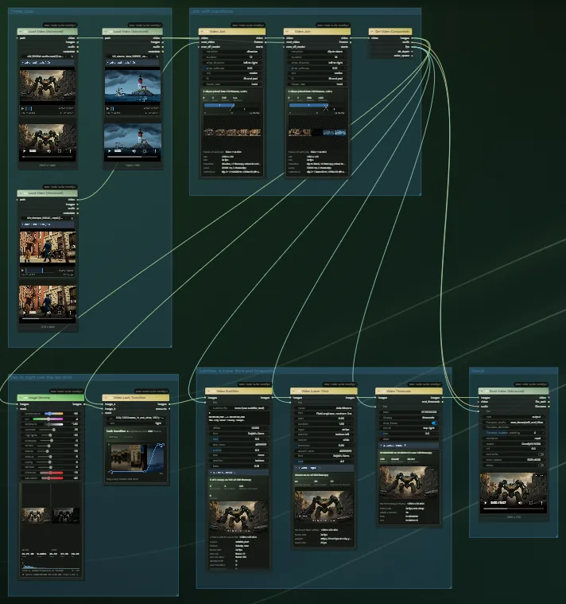</a> | **Edit and titles** | Three clips joined with transitions, a day to night grade eased in over the last shot, then subtitles, a lower third and timecode, saved with the sound. | [open](workflows/edit-and-titles.json) [download](https://raw.githubusercontent.com/WASasquatch/was-node-suite-comfyui/main/docs/workflows/edit-and-titles.json) |
| <a href="workflows/images/lower-third-styles.webp">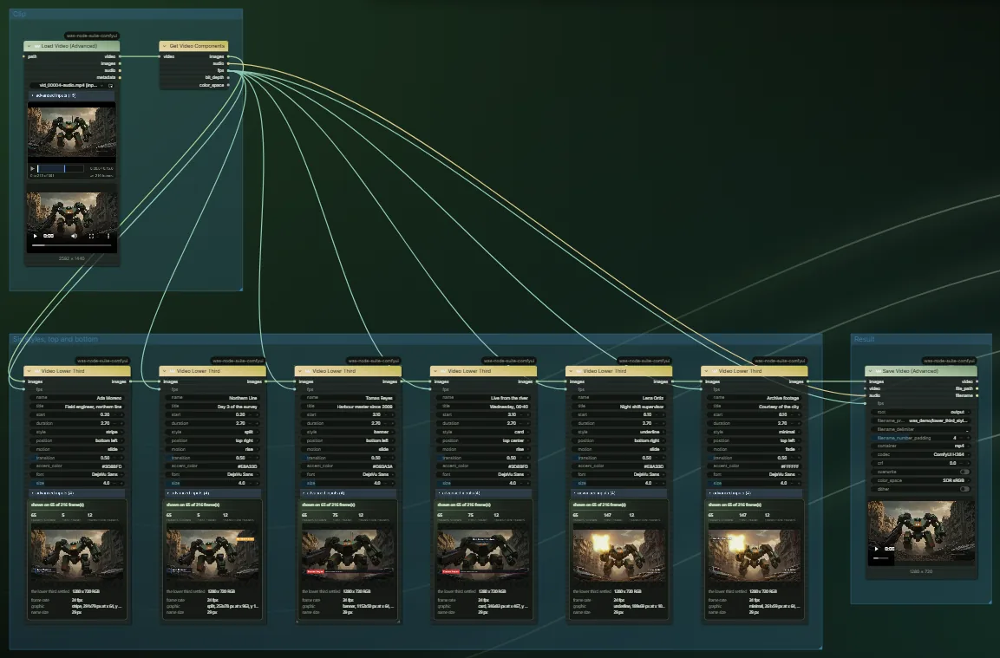</a> | **Lower third styles** | Six Video Lower Third graphics on one clip, two at a time, one at the top and one at the bottom: stripe, split, banner, card, underline and minimal, sliding, rising and fading in. | [open](workflows/lower-third-styles.json) [download](https://raw.githubusercontent.com/WASasquatch/was-node-suite-comfyui/main/docs/workflows/lower-third-styles.json) |
| <a href="workflows/images/subject-spotlight-video.webp">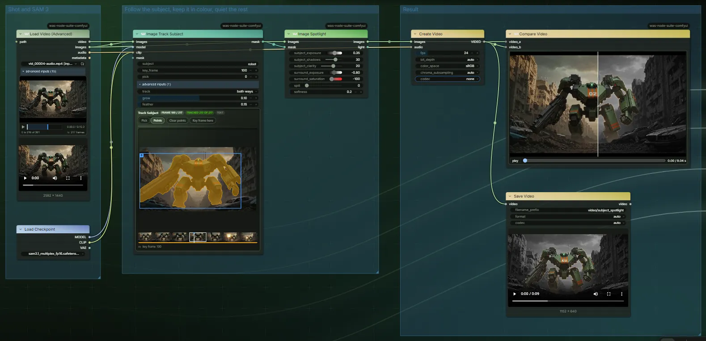</a> | **Subject spotlight on video** | A subject followed through a shot by Image Track Subject with SAM 3, kept in colour and lit by Image Spotlight while the rest is quieted, compared with the source. | [open](workflows/subject-spotlight-video.json) [download](https://raw.githubusercontent.com/WASasquatch/was-node-suite-comfyui/main/docs/workflows/subject-spotlight-video.json) |
|  | **Video motion with and without a flow model** | A clip's motion measured by Video Motion on its own and with a SEA-RAFT network, and film motion blur drawn along it by Video Motion Blur. | [open](workflows/motion_vector_model_difference.json) [download](https://raw.githubusercontent.com/WASasquatch/was-node-suite-comfyui/main/docs/workflows/motion_vector_model_difference.json) |
|  | **Video temporal upscale** | A clip upscaled 4x by Video Temporal Upscale with detail held steady along its motion, then scaled by half and saved with its sound. | [open](workflows/vtc_temporal_upscale.json) [download](https://raw.githubusercontent.com/WASasquatch/was-node-suite-comfyui/main/docs/workflows/vtc_temporal_upscale.json) |
| <a href="workflows/images/restore-footage.webp">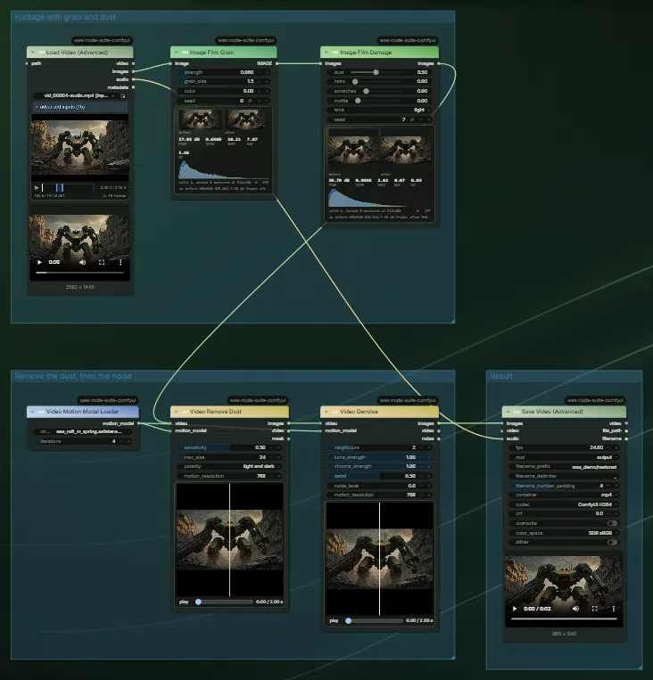</a> | **Restore grainy, dusty footage** | Video Remove Dust repairs one-frame specks from the neighbouring frames, then Video Denoise averages along the motion, each node showing the clip before and after. | [open](workflows/restore-footage.json) [download](https://raw.githubusercontent.com/WASasquatch/was-node-suite-comfyui/main/docs/workflows/restore-footage.json) |
| <a href="workflows/images/remove-object.webp">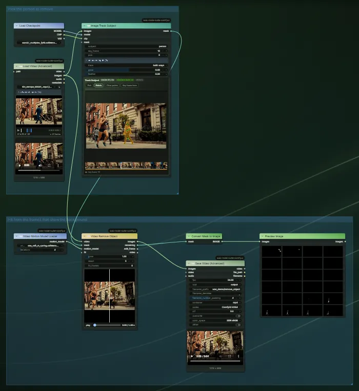</a> | **Remove a person from a clip** | Image Track Subject follows a clicked person with SAM 3, and Video Remove Object fills them in with background the other frames show, answering what no frame shows as a mask. | [open](workflows/remove-object.json) [download](https://raw.githubusercontent.com/WASasquatch/was-node-suite-comfyui/main/docs/workflows/remove-object.json) |
| <a href="workflows/images/h3-video-face-restore.webp">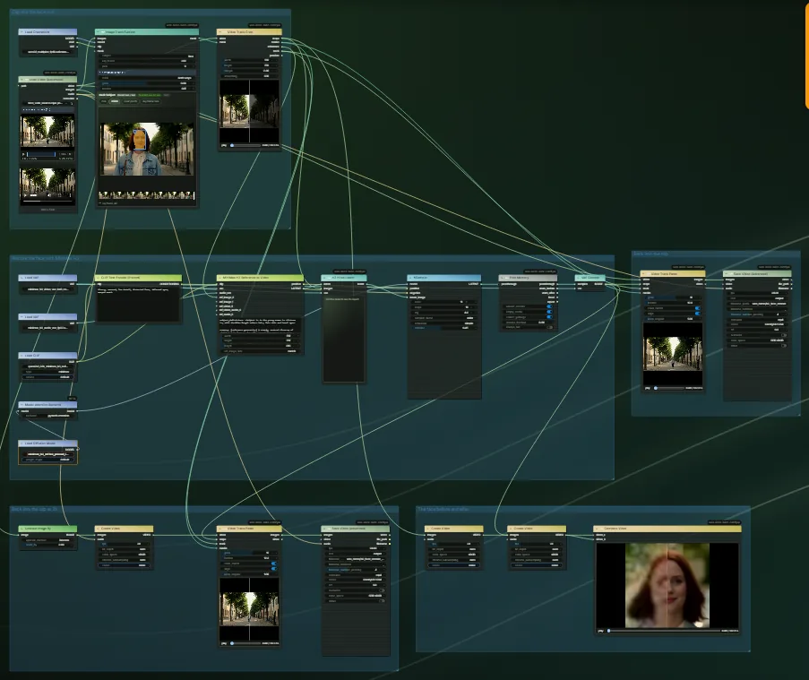</a> | **Restore a far-away face with MiniMax H3** | Image Track Subject follows a face up a walk-up shot, Video Track Crop holds it centred, MiniMax H3 ref2va redraws it with the clearest frame as reference, and Video Track Paste lays it back at 1x and 2x. | [open](workflows/h3-video-face-restore.json) [download](https://raw.githubusercontent.com/WASasquatch/was-node-suite-comfyui/main/docs/workflows/h3-video-face-restore.json) |

---

## 3D and Three.js

| Preview | Workflow | What it does | Get it |
|---|---|---|---|
|  | **A Three.js scene** | Every node in WAS Suite/Three in one scene: textures, materials, geometry, lights, two cameras, drawn on the canvas, rendered as frames and compiled into a web page. | [open](workflows/three-scene.json) [download](https://raw.githubusercontent.com/WASasquatch/was-node-suite-comfyui/main/docs/workflows/three-scene.json) |
|  | **Environment lighting** | A mirror, brushed metal, painted metal and clear glaze sphere lit by Three Environment. | [open](workflows/three-environment.json) [download](https://raw.githubusercontent.com/WASasquatch/was-node-suite-comfyui/main/docs/workflows/three-environment.json) |
|  | **Path tracing** | Boxes and spheres under an area light, path traced on the node and rendered as a still. | [open](workflows/three-path-tracing.json) [download](https://raw.githubusercontent.com/WASasquatch/was-node-suite-comfyui/main/docs/workflows/three-path-tracing.json) |
|  | **A skinned model playing its animation** | A rigged .dae model playing its own animation, rendered to video. Reads stormtrooper.dae and Stormtrooper_D.jpg from ComfyUI/input. | [open](workflows/three-skinned-model.json) [download](https://raw.githubusercontent.com/WASasquatch/was-node-suite-comfyui/main/docs/workflows/three-skinned-model.json) |
|  | **Camera tracking** | A camera kept on a walking model as it is carried around a turntable, by Three Track. | [open](workflows/three-camera-track.json) [download](https://raw.githubusercontent.com/WASasquatch/was-node-suite-comfyui/main/docs/workflows/three-camera-track.json) |
|  | **Tripo turntable** | A Tripo model from a prompt on a studio floor, rendered as a seamless 6 second turntable video and a path traced hero still. | [open](workflows/tripo-turntable.json) [download](https://raw.githubusercontent.com/WASasquatch/was-node-suite-comfyui/main/docs/workflows/tripo-turntable.json) |
|  | **Tripo HDRI showcase** | A Tripo model on a lacquer turntable plinth inside an HDRI panorama: a fast preview, a path traced turntable and a hero still. | [open](workflows/tripo-hdri-showcase.json) [download](https://raw.githubusercontent.com/WASasquatch/was-node-suite-comfyui/main/docs/workflows/tripo-hdri-showcase.json) |
|  | **Tripo reference sheet** | Eight views of a Tripo model, 45 degrees apart, saved as colour, depth and normal sheets. | [open](workflows/tripo-reference-sheet.json) [download](https://raw.githubusercontent.com/WASasquatch/was-node-suite-comfyui/main/docs/workflows/tripo-reference-sheet.json) |
|  | **Tripo render to art** | A Tripo model's three-quarter view and depth pass, painted in three styles through Z-Image Turbo's Fun ControlNet with the model's shape and camera kept. | [open](workflows/tripo-render-to-art.json) [download](https://raw.githubusercontent.com/WASasquatch/was-node-suite-comfyui/main/docs/workflows/tripo-render-to-art.json) |
|  | **Tripo walking character** | Z-Image Turbo concept art made into a textured Tripo character, rigged, given a walk and rendered as a seamless walk cycle on a turntable. | [open](workflows/tripo-character-walk.json) [download](https://raw.githubusercontent.com/WASasquatch/was-node-suite-comfyui/main/docs/workflows/tripo-character-walk.json) |
|  | **Drow adventurer turntable** | A drow adventurer from a prompt: concept art, a Tripo model and a path traced HDRI turntable, each stage a subgraph, every final exported. | [open](workflows/tripo-drow-turntable.json) [download](https://raw.githubusercontent.com/WASasquatch/was-node-suite-comfyui/main/docs/workflows/tripo-drow-turntable.json) |
|  | **Cave camp asset kit** | Twelve cave camp props made by Tripo from a sentence each, lightened with Smart Low Poly, kept in ComfyUI/input/tripo_assets and rendered as a lineup. | [open](workflows/tripo-cave-asset-kit.json) [download](https://raw.githubusercontent.com/WASasquatch/was-node-suite-comfyui/main/docs/workflows/tripo-cave-asset-kit.json) |
|  | **Drow in the cave camp** | The drow rigged and walking a circle around the fire in the dressed cave camp, lit by firelight and crystals, filmed by a wide camera and a chase camera. | [open](workflows/tripo-drow-scene.json) [download](https://raw.githubusercontent.com/WASasquatch/was-node-suite-comfyui/main/docs/workflows/tripo-drow-scene.json) |
|  | **Tripo character to a VRM avatar** | A head drawn by Z-Image and a body made by Tripo, assembled, rigged with the VRM skeleton by Tripo and locally, given hair springs, and saved as VRM and GLB. | [open](workflows/tripo-character-vrm.json) [download](https://raw.githubusercontent.com/WASasquatch/was-node-suite-comfyui/main/docs/workflows/tripo-character-vrm.json) |
|  | **Upscale a model's textures** | A model's six projections redrawn by MiniMax H3 Image at 67 megapixels, delit, read for roughness and surface direction, and recompiled into 4096 base colour, roughness and normal maps. | [open](workflows/3d-upscale-textures.json) [download](https://raw.githubusercontent.com/WASasquatch/was-node-suite-comfyui/main/docs/workflows/3d-upscale-textures.json) |

---

## Prompts and text

| Preview | Workflow | What it does | Get it |
|---|---|---|---|
|  | **Noodle Soup prompt terms** | Noodle Soup Pick choosing artists, colours and adjectives by hand and at random, Noodle Soup Term Edit refining the picks, and the result parsed into a prompt. | [open](workflows/noodle-soup-pick.json) [download](https://raw.githubusercontent.com/WASasquatch/was-node-suite-comfyui/main/docs/workflows/noodle-soup-pick.json) |
|  | **Prompt and style library** | Prompt terms and styles saved, exported and imported: a style saved from a prompt, the style library and the term pantry each written to a file and read back. | [open](workflows/prompt-library.json) [download](https://raw.githubusercontent.com/WASasquatch/was-node-suite-comfyui/main/docs/workflows/prompt-library.json) |
|  | **Multiline prompt lists** | Multiline Text Lists and Multiline Text (Advanced): one prompt per line with notes and switched-off lines left out, lists combined into whole prompts, and a wired string in place of the typed lines. | [open](workflows/prompt-lines.json) [download](https://raw.githubusercontent.com/WASasquatch/was-node-suite-comfyui/main/docs/workflows/prompt-lines.json) |
|  | **Prompts from a text file** | Load Text Line reading a prompt file whole, at an index and at random from a seed, with every line handed on as a list. | [open](workflows/prompt-lists.json) [download](https://raw.githubusercontent.com/WASasquatch/was-node-suite-comfyui/main/docs/workflows/prompt-lists.json) |
|  | **Repair a model's JSON** | JSON Validate repairing a language model's answer into JSON other nodes can read, and checking one without changing it while the run goes on. | [open](workflows/json-validate.json) [download](https://raw.githubusercontent.com/WASasquatch/was-node-suite-comfyui/main/docs/workflows/json-validate.json) |
|  | **Fast Generate Text** | Fast Generate Text and ComfyUI's Text Generate writing from one prompt on the same Qwen3 text encoder, side by side. | [open](workflows/fast-generate-text.json) [download](https://raw.githubusercontent.com/WASasquatch/was-node-suite-comfyui/main/docs/workflows/fast-generate-text.json) |
|  | **Language Model Loader** | A language model loaded by Language Model Loader as a CLIP and used by Fast Generate Text to write. | [open](workflows/language-model-loader.json) [download](https://raw.githubusercontent.com/WASasquatch/was-node-suite-comfyui/main/docs/workflows/language-model-loader.json) |
|  | **System prompt library** | System prompts saved to the library and loaded back to steer Fast Generate Text. | [open](workflows/system-prompt-library.json) [download](https://raw.githubusercontent.com/WASasquatch/was-node-suite-comfyui/main/docs/workflows/system-prompt-library.json) |
|  | **Built-in prompt enhancers** | A short idea expanded by a built-in system prompt, then rendered as typed and as expanded on the same seed. | [open](workflows/built-in-prompt-enhancers.json) [download](https://raw.githubusercontent.com/WASasquatch/was-node-suite-comfyui/main/docs/workflows/built-in-prompt-enhancers.json) |

---

## Language models and Llama-Index

| Preview | Workflow | What it does | Get it |
|---|---|---|---|
|  | **LLM Loader** | One picture captioned twice through LLM Loader and LLM Complete: JoyCaption as a GGUF on llama.cpp with its mmproj found beside it, and Qwen3-VL 4B as a safetensors file on ComfyUI. | [open](workflows/llm-loader.json) [download](https://raw.githubusercontent.com/WASasquatch/was-node-suite-comfyui/main/docs/workflows/llm-loader.json) |
|  | **Chat with a folder of notes** | A folder of notes indexed for keyword and meaning search, fused and reranked, and a chat about them with a local model, kept between runs. | [open](workflows/llm-chat-with-notes.json) [download](https://raw.githubusercontent.com/WASasquatch/was-node-suite-comfyui/main/docs/workflows/llm-chat-with-notes.json) |
|  | **Find pictures by what they show** | A folder of renders indexed by picture, searched by a sentence and by an example picture, with a vision model asked about what it found. | [open](workflows/llm-picture-search.json) [download](https://raw.githubusercontent.com/WASasquatch/was-node-suite-comfyui/main/docs/workflows/llm-picture-search.json) |
|  | **Research agent** | An agent with three tools, a folder of notes, a calculator and dates, answering a question by calling them. | [open](workflows/llm-research-agent.json) [download](https://raw.githubusercontent.com/WASasquatch/was-node-suite-comfyui/main/docs/workflows/llm-research-agent.json) |
|  | **Retrievers compared** | Studio notes and tables searched five ways: recursive, routed by the model, with model-written metadata filters, with HyDE, and by SQL. | [open](workflows/llm-retrievers.json) [download](https://raw.githubusercontent.com/WASasquatch/was-node-suite-comfyui/main/docs/workflows/llm-retrievers.json) |
|  | **Questions about a spreadsheet** | A spreadsheet answered by a SQL query engine, and its rows searched by meaning. | [open](workflows/llm-table-questions.json) [download](https://raw.githubusercontent.com/WASasquatch/was-node-suite-comfyui/main/docs/workflows/llm-table-questions.json) |
|  | **Text, pictures, video and tables in one index** | Text, a picture, a video and a table turned into documents and indexed together, then searched and shown as pictures. | [open](workflows/llm-to-documents.json) [download](https://raw.githubusercontent.com/WASasquatch/was-node-suite-comfyui/main/docs/workflows/llm-to-documents.json) |
|  | **Vector store** | An index kept in a vector store between runs, and a document added to the stored index. | [open](workflows/llm-vector-store.json) [download](https://raw.githubusercontent.com/WASasquatch/was-node-suite-comfyui/main/docs/workflows/llm-vector-store.json) |
|  | **MOSS-Image prompt from a skill** | A MOSS-Image prompt written by a system prompt skill with its references looked up in an index, compiled for MOSS-Image. | [open](workflows/llm-skill-prompt-enhancer.json) [download](https://raw.githubusercontent.com/WASasquatch/was-node-suite-comfyui/main/docs/workflows/llm-skill-prompt-enhancer.json) |
|  | **Code writing conversation** | A request planned, written, reviewed and revised by four language model roles until the review passes, then held on the canvas for feedback that starts the next round. | [open](workflows/llm-code-writing.json) [download](https://raw.githubusercontent.com/WASasquatch/was-node-suite-comfyui/main/docs/workflows/llm-code-writing.json) |
|  | **ComfyUI node writing conversation** | The code writing conversation with a ComfyUI node authoring skill joined to every role, writing a standalone custom node package. | [open](workflows/llm-node-writing.json) [download](https://raw.githubusercontent.com/WASasquatch/was-node-suite-comfyui/main/docs/workflows/llm-node-writing.json) |

---

## Files, datasets and documents

| Preview | Workflow | What it does | Get it |
|---|---|---|---|
|  | **Captioned training set** | A captioned training set checked for health and caption statistics, its captions fixed and saved in place, flagged pictures dropped, and tags removed, renamed and pinned. | [open](workflows/caption-datasets.json) [download](https://raw.githubusercontent.com/WASasquatch/was-node-suite-comfyui/main/docs/workflows/caption-datasets.json) |
|  | **Caption a folder of images** | A folder of images captioned by Fast Generate Text and saved with a caption file beside each picture. | [open](workflows/image-save-captions.json) [download](https://raw.githubusercontent.com/WASasquatch/was-node-suite-comfyui/main/docs/workflows/image-save-captions.json) |
|  | **Folder round trip** | Images read from a folder by Load Image Sequence, auto-levelled and saved back as a set. | [open](workflows/folder-round-trip.json) [download](https://raw.githubusercontent.com/WASasquatch/was-node-suite-comfyui/main/docs/workflows/folder-round-trip.json) |
|  | **Pose library search** | A folder of pose photographs searched by a prompt, the best match turned into a ControlNet depth map. | [open](workflows/image-library-pose-search.json) [download](https://raw.githubusercontent.com/WASasquatch/was-node-suite-comfyui/main/docs/workflows/image-library-pose-search.json) |
|  | **Content Viewer** | Content Viewer showing a picture, its statistics, a loaded document, rich text and an exported document, each in the view that suits it. | [open](workflows/content-viewer.json) [download](https://raw.githubusercontent.com/WASasquatch/was-node-suite-comfyui/main/docs/workflows/content-viewer.json) |
|  | **Document export** | Text and metadata saved as a document in .wasdoc, .docx and .odt, with each file's metadata read back. .docx and .odt need the document_export group. | [open](workflows/document-export.json) [download](https://raw.githubusercontent.com/WASasquatch/was-node-suite-comfyui/main/docs/workflows/document-export.json) |
|  | **Zip archives** | Documents added to a zip in folders, an archive opened and its entries picked on the node, and the result saved. Reads review_comments.zip from ComfyUI/input. | [open](workflows/zip-archives.json) [download](https://raw.githubusercontent.com/WASasquatch/was-node-suite-comfyui/main/docs/workflows/zip-archives.json) |

---

## Logic, loops and apps

| Preview | Workflow | What it does | Get it |
|---|---|---|---|
|  | **App Workflow** | A workflow saved in app mode run as one node by App Workflow, its inputs set on the node and its results on wires. Copy the .app.json files below into ComfyUI/user/default/workflows. | [open](workflows/app-workflow.json) [download](https://raw.githubusercontent.com/WASasquatch/was-node-suite-comfyui/main/docs/workflows/app-workflow.json) |
|  | **App: caption and chromatic aberration** | An app mode workflow for App Workflow: chromatic aberration and a caption drawn on a picture. | [open](workflows/app-workflow-example.app.json) [download](https://raw.githubusercontent.com/WASasquatch/was-node-suite-comfyui/main/docs/workflows/app-workflow-example.app.json) |
|  | **App: resize and sharpen** | An app mode workflow for App Workflow: a picture resized and sharpened. | [open](workflows/app-workflow-resize.app.json) [download](https://raw.githubusercontent.com/WASasquatch/was-node-suite-comfyui/main/docs/workflows/app-workflow-resize.app.json) |
|  | **App: a subgraph inside** | An app mode workflow for App Workflow whose filters sit inside a subgraph. | [open](workflows/app-workflow-subgraph.app.json) [download](https://raw.githubusercontent.com/WASasquatch/was-node-suite-comfyui/main/docs/workflows/app-workflow-subgraph.app.json) |
|  | **App: find and replace text** | An app mode workflow for App Workflow that takes text and runs find and replace on it. | [open](workflows/app-workflow-text.app.json) [download](https://raw.githubusercontent.com/WASasquatch/was-node-suite-comfyui/main/docs/workflows/app-workflow-text.app.json) |
|  | **Execution Gate** | One branch passed by Execution Gate and one stopped, so everything after the closed gate is skipped. | [open](workflows/execution-gate.json) [download](https://raw.githubusercontent.com/WASasquatch/was-node-suite-comfyui/main/docs/workflows/execution-gate.json) |
|  | **Execution Gate Controlboard** | Execution Gates and an Any Gate switched on and off from one Execution Gate Controlboard. | [open](workflows/execution-gate-controlboard.json) [download](https://raw.githubusercontent.com/WASasquatch/was-node-suite-comfyui/main/docs/workflows/execution-gate-controlboard.json) |
|  | **For Loop** | A For Loop of five passes carrying a running total. | [open](workflows/loops-for-loop.json) [download](https://raw.githubusercontent.com/WASasquatch/was-node-suite-comfyui/main/docs/workflows/loops-for-loop.json) |
